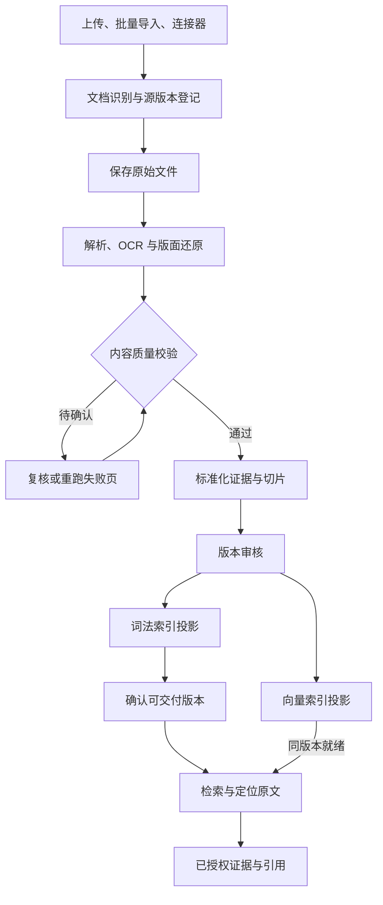

# 企业级知识库设计与检索质量工程

**副标题：从多源资料采集，到可检索、可引用、可持续维护的知识服务**  
**主线项目：企业内部知识库｜首季 16 期｜规划日期：2026-11-18｜修订：2026-11-20**

## 1. 系列定位

搭建一家虚构 B2B 软件公司的内部知识库。公司已有制度 PDF、扫描件、办事表格、Wiki、Git 手册和项目资料。课程沿着材料的完整生命周期讲解：**盘点与收集 → 接入与留存 → 识别与清洗 → 证据建模与切片 → 入库与发布 → 词法及语义检索 → 带引用问答 → 更新、撤权与治理**。

工程验收围绕同一个承诺。给定提问者、问题和业务日期，系统能交付此人有权访问、对问题确实适用、在指定时间有效的证据，并定位到原始文件的页、段落、表格单元格或幻灯片。证据缺失、识别质量待确认或规则冲突时，系统能说明用户有权限知道的缺口，管理员也能定位问题发生的环节。

面向具备 TypeScript / Node.js 后端基础的工程师、AI 应用工程师和技术负责人。正文以设计为主。每期用同一个业务案例串起约束、设计依据、核心逻辑、代码走读和边界验证。接口、数据模型和责任边界从案例推导，方案取舍说明何时值得更换实现。课程组织参考 [Agent 第 01 期](https://github.com/ashuaze/agent-engineering/blob/main/lessons/agent-engineering-week-01-2026-10-12.md)、[第 02 期](https://github.com/ashuaze/agent-engineering/blob/main/lessons/agent-engineering-week-02-2026-10-23.md)、[第 03 期](https://github.com/ashuaze/agent-engineering/blob/main/lessons/agent-engineering-week-03-2026-10-30.md)。

## 2. 一家公司、三类知识、同一个验收问题

| 知识域 | 已有资料形态 | 负责维护和确认的人 | 要解决的查询 |
| --- | --- | --- | --- |
| IT 支持 | Git Markdown、服务台 Wiki、版本切换公告、管理员手册 | IT 支持和系统负责人 | 换了手机怎么重新绑定验证器？`KB-4032` 怎么处理？ |
| HR / 行政 | 有文本层的 PDF、扫描盖章的旧版制度、DOCX 入场指南、XLSX 办理矩阵 | HR 与行政制度负责人 | 外包同事入场要带什么？开门禁由谁申请？当前与历史规则有何不同？ |
| 研发 / 项目 | Git 文档、项目 Wiki、共享盘里的 PDF/PPTX、受限项目手册 | 项目负责人及空间管理员 | Atlas 联调使用哪个接口版本？哪些操作只有项目成员能看到？ |

**主线验收问题**是「下周有一位外包工程师加入 Atlas 项目，第一天要办什么、找谁开通权限？」一份扫描入场规定提供办理条件，表格给出负责人，IT Wiki 提供申请入口，项目手册提供成员可读的联调说明。让普通员工与 Atlas 成员分别查询同一业务对象。公开且适用的证据应一致，项目内容按提问者的权限显示。未来日期以组织的业务时区解释；已正式发布但待生效的规则可以在显式预览中标为计划适用，当天操作继续走当前有效制度。首期已发布的本地实验仅支持当前及历史业务日期。

贯穿全季的事件是**重新上传扫描制度、纠正一页 OCR 错误、发布新版本、撤回项目手册权限**。沿同一份实际使用的材料设计上传记录、页级处理、引用、索引发布和权限复核。复用首期已有的 19 个文档实体、22 个版本及 20 个查询场景，再按设计需求逐步增加合成资料。

### 格式差异如何影响设计

| 资料形态 | 建议处理方式 | 证据定位与归档 |
| --- | --- | --- |
| Wiki／网页 HTML、Markdown | 解析标题树、正文、代码和表格，去除模板导航与重复版式；内容和权限分别采集 | 原始快照 + 元素锚点或源行号 |
| 可选中文字的 PDF | 优先抽取文本层并验证阅读顺序，必要时执行版面分析 | 版本 + 页码 + 坐标／文本范围 |
| 扫描 PDF、图片、混合 PDF | 按页或区域路由 OCR 与版面识别；记录结果置信度和待复核页 | 原始图像／页面 + 识别块坐标；保留原件供复核 |
| DOCX | 保留标题、段落、列表、表格、脚注；验证源结构里嵌入图表的可读性 | 原件版本 + 段落或表格定位；渲染页可作为辅助 |
| PPTX | 保留页序、标题、文本框、图表和必要讲者备注；明确备注的索引权限 | 原件版本 + 幻灯片号 + 元素 |
| XLSX／CSV | 保留 sheet、表头层级、行列、单位与业务键；区分公式、显示值及空值；大表可投影到结构化查询路径 | 工作表 + 单元格范围；引用结构化计算时附口径 |
| 附件、图片、邮件和聊天记录 | 按来源治理决定是否纳入。附件可复用文件流程；邮件和聊天的上下文、可见人群与权威性单独设计 | 线程或消息定位 + 附件关联；旁证的有效性由知识所有者确认 |

首季提供常见格式的选型和设计示例，以 **Markdown/HTML、数字 PDF、扫描 PDF、办公文档与表格**示范主要分支。接入接口和增量同步以批量导入及模拟连接器讲解；各家连接器的生产适配、实时协同、多租户、大规模跨地域部署作为后续扩展。全季使用合成资料与身份夹具，真实企业的权限继承、留存周期和接入边界需按本组织规则确定。

## 3. 工作流、存储边界与状态设计



候选版本经过审核后构建派生索引。必需索引就绪、原文可引用且发布条件满足时，才把该版本切成可交付版本。检索时按当前权限和业务有效时间复核，再决定是否交付。应急废止可以先让权威目录停止交付旧版，允许运营在确认新内容前看到明确的知识缺口。

| 对象／产物 | 参考存储 | 核心内容与用途 |
| --- | --- | --- |
| 原件和页面产物 | 私有对象存储 | 原始字节、校验和、图像和解析产物，以版本记录关联；供来源页、复核及重新处理 |
| 来源与文档版本 | PostgreSQL | `source_system`、`source_record_id`、源版本标识、内容指纹、原件引用、所有者、发布状态、适用人群、生效区间 |
| 权限与来源映射 | PostgreSQL／组织权限服务 | 资源 ACL、上游主体与组织身份映射、同步时间、策略版本 |
| 规范化证据 | JSON 产物与目录表 | 原文块、表格结构、来源定位、解析器版本和质量判定；便于比较重跑结果 |
| 入库任务与尝试 | PostgreSQL | 各阶段状态、重试次数、失败页、产物引用、处理版本及幂等键 |
| 词法／向量索引 | OpenSearch | 文本、精确字段、嵌入、证据范围、可过滤的版本和权限投影、索引代次；支持按权威数据重建 |

### 三种状态分别回答什么

| 轴线 | 所回答的问题 | 典型值 |
| --- | --- | --- |
| 处理任务 | 文件是否完成处理，哪个步骤要补做？ | 已接收、处理中、待复核、成功、失败；按阶段记录 |
| 知识版本 | 哪份内容具备发布资格，在哪一天适用？ | 草稿、已批准、已发布、已撤回；独立记录业务生效区间 |
| 查询可见性 | 哪一路检索已就绪，当前服务使用哪个代次？ | 词法待就绪／就绪、向量待就绪／就绪；记录服务中的代次 |

例如扫描规定只识别了 7/8 页，且缺失的是批准条件，应进入待复核。词法索引已就绪而向量尚在重试时，如果受控证据已齐备且词法符合发布门槛，可先开放词法查询，向量补齐后再升级混合检索。这样的状态定义能向上传人解释进度，也便于运营定位「文件上传成功但搜不到」的原因。

### 从最小方案演进

| 设计决策 | 起步方案 | 触发演进的条件 |
| --- | --- | --- |
| 已知来源和数据采集 | 文件上传、批量校验和干跑预览 | 数据量或更新频率增加，接入带游标同步的连接器并做定期对账 |
| 处理执行和恢复 | API 登记，独立 worker 读取持久化任务，按阶段记录产物和重试 | OCR、Embedding 的队列和并发需求分化时分池；跨系统事件发布可引入事务 Outbox |
| 解析策略 | 数字文档先走原生解析，按页或区域回退 OCR | 图表和多栏效果不稳，加入文档版面模型、低置信复核和按版式验收 |
| 发布与索引 | 先有可引用的原文证据及词法投影 | 口语查询缺口明确时加入 Embedding，配置可重复回放的索引切换与回滚 |

TypeScript + Fastify 用来表达接口与服务边界，PostgreSQL 保存目录、任务和授权，私有对象存储保留文件及产物，OpenSearch 负责派生索引。具体解析器、OCR 服务、Embedding 模型与队列按准确率、运行位置、成本和故障模型选型。参考实现及各期验证状态单独说明。

## 4. 首季 16 期大纲

### 第一阶段｜从企业资料到可交付的知识版本

#### 01｜企业知识库如何判定一条搜索结果可以交付？（已发布）

- **设计主线**。由过期 MFA 指引排第一推导检索契约，拆解相关性、读取权、业务适用性和有效期。区分文档、版本、原文证据与索引片段。
- **边界场景**。切换日、草案与未来生效、提问者替外包同事查询、追溯生效、旧索引命中、来源链接复核。
- **方案示例**。`QueryContext`、版本有效期判定、交付前复核与现行／历史索引对照。
- **验收**。同一问题在两个业务日期或不同提问者下可按契约解释。可选用原有 MFA 回放验证。 [第一期正文](lessons/enterprise-knowledge-base-ep01.md)

#### 02｜企业资料散在各处，怎样收集并接入知识库？（已发布）

- **设计主线**。从知识使用任务反推来源盘点、所有者、权威级别、许可范围和更新频率。设计人工上传、批量导入与 API 连接器共用的来源契约和原件登记。
- **边界场景**。上传未完成、格式和文件名不一致、重复报送、文件名或路径改变、同内容跨来源与权限边界、连接器速率限制、游标失效、上游记录消失或撤权。
- **方案示例**。受控上传 → 文件校验 → 版本登记 → 创建处理任务；文件校验包括类型、大小和解析前隔离。提供 `SourceRecord`、内容指纹、版本键、ACL 映射、游标持久化和干跑导入报告。分别比较全量轮询、增量游标和事件触发加对账。 [OWASP 文件上传指南](https://cheatsheetseries.owasp.org/cheatsheets/File_Upload_Cheat_Sheet.html) · [Microsoft Graph 增量查询](https://learn.microsoft.com/en-us/graph/delta-query-overview)
- **验收**。同一文件重传只产生一次指定的导入效果，移动目录仍可追踪来源；导入管理员能够解释哪些来源失败、缺权限或需要重新同步。 [阅读全文](lessons/enterprise-knowledge-base-ep02.md)

#### 03｜从 PDF、图片、表格和办公文档中得到可信内容（已发布）

- **设计主线**。先识别载体和有效文本层，再做解析、OCR、版面还原与清洗。优先保留结构、业务字段和来源坐标；为清洗规则记录版本和剔除理由。
- **边界场景**。混合 PDF、双栏阅读顺序、旋转或模糊页面、表头跨页、重复页眉、隐藏文本、数字和日期识错、关键页部分失败、办公表格中的公式与显示值。
- **方案示例**。给出解析路由、统一的 `ParsedBlock`、按页 OCR 与重试、关键字段复核和质量门槛。以「第 4 页门禁表格漏识别」演示如何定位原页、重跑该页并合并为新的处理产物。比较本地解析、托管文档智能和人工校验的适用条件。 [Microsoft Document Intelligence 版面分析](https://learn.microsoft.com/en-us/azure/ai-services/document-intelligence/prebuilt/layout)
- **验收**。每条关键规则可定位到原页或单元格。跨页表头、日期、单位和办理人可人工抽查；关键页缺失时版本停在待复核，上传人可看到原因。 [阅读全文](lessons/enterprise-knowledge-base-ep03.md)

#### 04｜内容已经读出来，怎样切成能搜索和引用的证据？（已发布）

- **设计主线**。从规范化结构到证据单元与可检索片段，推导标题继承、表格上下文、列表条件和跨段落组合。证据定位关联文档版本，索引片段可随策略重建。
- **边界场景**。跨行表头、参考链接、条件步骤、多页长表、代码及错误码、同名标题、页码和版式变化、片段过大或过小。
- **方案示例**。同一份入场规则分别做固定长度、结构感知和父子片段切分；对大表展示带列名的文本片段、结构化查询、原单元格引用如何配合。
- **验收**。取任一片段仍能理解办理条件和责任人。切片策略改变后，可用同一套原文证据标注比较质量。 [阅读全文](lessons/enterprise-knowledge-base-ep04.md)

#### 05｜原件、切片和索引各存哪里，什么时候算入库成功？（已发布）

- **设计主线**。设计处理任务、发布生命周期和查询可见性。区分原件及处理产物、权威文档目录、可重建索引，明确每条写入的责任方和失败后恢复点。
- **边界场景**。原件已写但目录还未登记、worker 重试、部分页成功、索引部分写入、词法可用但向量计算失败、旧任务完成晚于新版本、待生效版本提前建索引。
- **方案示例**。给出任务表、阶段幂等键、结果对象、审核与发布流程、状态 API 和重跑入口。比较持久化任务表与独立队列；需要跨服务发事件时给出事务 Outbox 的落点。 [AWS 事务 Outbox 设计模式](https://docs.aws.amazon.com/prescriptive-guidance/latest/cloud-design-patterns/transactional-outbox.html)
- **验收**。重复处理不产生多份可见证据，关键产物缺失无法通过发布门槛；遇到中途失败可以解释状态并从合适阶段恢复。 [阅读全文](lessons/enterprise-knowledge-base-ep05.md)

### 第二阶段｜从索引字段到混合检索

#### 06｜错误码为什么搜不到？从 BM25 建立词法基线（已发布）

- **设计主线**。用短文档手算 BM25 的词频、逆文档频率与长度因素，分清分析器、字段表示、候选匹配和排序。
- **边界场景**。中文与英文混排、大小写、连字符、相近错误码、缩写歧义、长文档稀释与标题过强。
- **方案示例**。为错误码设计规范化精确字段，为标题和正文配置全文字段。演示从词项分析与命中解释定位问题，并说明何时保留口语召回缺口。
- **验收**。能从字段映射和分析器解释 `KB-4032` 如何命中；保留一条长文档标题命中但证据段不适用的反例。 [阅读全文](lessons/enterprise-knowledge-base-ep06.md)

#### 07｜向量找到了意思相近的文档，为什么还是没用？（已发布）

- **设计主线**。解释从输入表示、Embedding 到相似度和向量索引的职责，用精确搜索作为近似搜索的质量参照。
- **边界场景**。口语同义、错误码和数值、跨部门同名概念、业务适用性偏差、切片过短、混用不同向量版本。
- **方案示例**。同一切片和资格规则下配置词法与向量路线。给出嵌入版本、输入哈希、批量写入、失败重试和模型升级重算的最小流程。向量输入沿用已批准的内容处理边界。
- **验收**。给定口语改写、精确错误码和权限受限的三条查询，指出每条需要哪类信号，什么样的对照可以检验答案。 [阅读全文](lessons/enterprise-knowledge-base-ep07.md)

#### 08｜BM25 和向量怎么合并？先做可解释的混合基线（已发布）

- **设计主线**。拆解候选集、融合、段落去重与文档归并。推导 RRF，说明排名融合与分数归一化各自依赖什么假设。
- **边界场景**。一路超时、一方候选很浅、同页切片占满 Top K、过滤后候选不足、两路都漏同一答案。
- **方案示例**。手算两路排名，写出 RRF 与去重的伪代码，并展示候选深度及超时降级配置如何影响结果。
- **验收**。在同一返回预算下诊断「结果更多却覆盖更窄」，给出可解释的去重单位和分组验收条件。 [阅读全文](lessons/enterprise-knowledge-base-ep08.md)

#### 09｜重排值不值得上？用延迟预算换排序质量（已发布）

- **设计主线**。用候选召回上限说明重排的作用，区分字段规则、模型打分和业务约束，推导端到端延迟预算。
- **边界场景**。正确候选没召回、输入截断、受限或敏感段落、模型超时、候选变多带来的尾延迟。
- **方案示例**。给出候选预算、授权复核、重排适配接口、超时降级和观测配置。对同一候选集比较原排序、规则和模型重排。
- **验收**。说明在哪个质量和延迟区间值得启用重排，以及运行失败时如何回退到可交付的基线。 [阅读全文](lessons/enterprise-knowledge-base-ep09.md)

### 第三阶段｜企业权限与知识版本治理

#### 10｜同一个问题，为什么两个人该看到不同结果？（已发布）

- **设计主线**。分开建模提问者、组成员关系、资源 ACL 与业务对象。查询时收窄搜索范围，交付前向权威策略复核。
- **边界场景**。跨项目、组继承、撤权但索引或缓存仍旧、授权源不可用、标题与摘要侧漏、历史查询复用当前权限。
- **方案示例**。给出上游 ACL 映射和组关系模型、查询前过滤与批量权威复核接口，跟踪撤权后搜索、缓存、来源下载和外部重排的行为。
- **验收**。能为 Atlas 成员和普通员工写出同问异果的验收用例，明确受限内容可经过的组件与失败处理。 [阅读全文](lessons/enterprise-knowledge-base-ep10.md)

#### 11｜文档删了，搜索为什么还找得到？（已发布）

- **设计主线**。区分生效时间、接收时间和索引可见时间。设计变更消费、幂等、版本检查、废止记录、全量重建和增量追赶。
- **边界场景**。重复投递、乱序、旧数据复活、重建期间连续更新、同源记录换路径、内容与权限同步节奏不同。
- **方案示例**。展示源事件去重、版本单调检查、删除记录、重建水位与追赶时序。比较已撤回版本的受控归档、源端删除和到期销毁对原件、处理产物与索引的不同影响。
- **验收**。给定一组乱序的发布和删除事件，推导最终索引状态，说明故障时哪项权威数据仍可阻止交付。 [阅读全文](lessons/enterprise-knowledge-base-ep11.md)

#### 12｜Wiki 和制度写得不一样，该相信谁？（已发布）

- **设计主线**。给制度权威、适用范围和冲突建立规则。区分内容、索引与授权的缓存失效节奏。
- **边界场景**。两份正式制度有效期重叠、Wiki 摘要滞后、项目补充条款、追溯生效、同一查询跨身份复用缓存。
- **方案示例**。提供权威来源与例外规则表、冲突状态、缓存键与复核点，展示何时报告冲突、何时引用更具体的授权规则。
- **验收**。在一份正式制度和一份项目说明同时命中时，说明可支持的结论、冲突处置和缓存应携带的上下文。 [阅读全文](lessons/enterprise-knowledge-base-ep12.md)

### 第四阶段｜证据问答、迭代与上线运营

#### 13｜答案带了链接，怎么证明链接真的支持答案？（已发布）

- **设计主线**。拆开证据检索、证据组合与生成。定义逐项主张、原文定位及充分、部分充分、缺失和冲突的结果契约。
- **边界场景**。链接内容没支撑结论、证据缺失或相互冲突、跨段落条件丢失、检索内容含恶意指令、生成器只收到有限证据。
- **方案示例**。给出主张与证据引用的结构、合成的 Atlas 综合题和四种证据状态的响应示例。
- **验收**。把一段答案拆成可核验主张，判断各项证据是否覆盖动作、对象、时间和例外。 [阅读全文](lessons/enterprise-knowledge-base-ep13.md)

#### 14｜用户说「这条搜不出来」，怎么把它变成回归测试？（已发布）

- **设计主线**。从用户投诉还原来源、处理批次、身份、时间和索引代次，再按接入、识别清洗、索引可见性、资格、召回、排序、交付和生成定位问题。
- **边界场景**。正确空页、资料本身缺失、解析丢字段、配置变了但旧评测未更新、样本改写在训练与留出集中重复、日志中出现受限信息。
- **方案示例**。展示脱敏诊断事件、坏例报告和标注结构，给出一对相似表象但不同归因的记录。
- **验收**。将一次失败写成可回放案例，选择正确的断言和数据分组。 [阅读全文](lessons/enterprise-knowledge-base-ep14.md)

#### 15｜替换解析器、切片或 Embedding，怎么知道可以上线？（已发布）

- **设计主线**。比较基线与候选配置，设计影子评测、小流量切换、索引代次和回滚。发布门槛同时考虑质量、延迟、新鲜度与授权。
- **边界场景**。总体平均上涨但关键查询族退化、冷索引 P95 抬高、新旧索引不同步，回滚后旧权限仍出现在派生索引。
- **方案示例**。以更换解析器、切片或 Embedding 为例，给出变更记录、分组门槛、影子对照、索引别名切换／回滚时序，以及独立于检索配置的权威权限复核。 [OpenSearch 索引别名](https://docs.opensearch.org/latest/im-plugin/index-alias/)
- **验收**。用一份带退化组和权限失败的数据作上线决策，并写出恢复条件。可选回放一次索引切换或评测退化场景。 [阅读全文](lessons/enterprise-knowledge-base-ep15.md)

#### 16｜企业知识库上线后，谁来维护，怎么持续改进？（已发布）

- **设计主线**。建立知识所有者与平台的责任分工、资料接入与下线流程、内容复核周期、服务目标和成本观测。选择试点范围，从少数高价值流程扩大覆盖。
- **边界场景**。资料长期无人维护、来源停止同步、积压超时、积压恢复压垮 OCR 或 Embedding 下游、错误率集中于某类格式、留存期到期。
- **方案示例**。给出知识源责任表、试点上线清单、按格式和处理阶段的告警面板、补跑与限流手册，以及带授权复核的跨部门验收脚本设计。
- **验收**。完整演示 Atlas 入场问题从原件登记到有引用答案。能够解释一条失败告警的责任归属、如何恢复、哪些证据可继续服务，以及何时需要人工确认。 [阅读全文](lessons/enterprise-knowledge-base-ep16.md)

## 5. 验收贯穿资料进库、检索和治理

样本按「资料格式 × 处理状态 × 查询 × 身份 × 业务日期」选取高价值组合，覆盖失效版本、表格跨页、OCR 错字、来源延迟和权限差异。数据和规则采用版本化的标注，便于用同一份证据比较改动。单独记录合成案例、已实测结果和待验证设计。

| 环节 | 验收指标或断言 | 样例 |
| --- | --- | --- |
| 接入 | 可对账的来源覆盖率、同步延迟、幂等重放、原件可追踪 | 同一版本重传后仍只有一个活跃版本；游标中断后能恢复 |
| 识别与清洗 | 文本块与表格字段保留率、关键字段准确率、来源定位、失败页可见性 | 关键门禁表格中的办理人、日期与单位对照原件校验 |
| 入库与发布 | 分阶段耗时、处理积压、到可查询时间、部分失败与重跑后的结果一致性 | 关键页缺失时待复核；词法就绪后可按策略先服务 |
| 搜索 | 证据 Recall@K、MRR、错误码与口语查询分组、预期空页 | 同一条问题改写后仍应指向同一证据簇 |
| 引用与回答 | 引用可定位率、主张支持率、部分证据、缺失与冲突的表达 | 能定位到扫描页和办理矩阵对应范围；缺资料时说明缺口 |
| 权限、版本与删除 | 当前与历史查询测试、越权返回数、撤权覆盖、删除对账 | 任一越权输出即阻断发布；旧索引命中时仍走当前授权 |
| 运行与发布 | P95、数据新鲜度、未处理积压、限流、切换与回滚演练 | 平均指标上升但关键查询组下降时按该组门槛决策 |

沿用「解析 → 候选资格 → 召回 → 排序 → 交付」的检索诊断，并补上来源接入、处理质量、索引可见性和发布状态。查询端保留结构化诊断信号。运营侧可以关联批次、文件、页和索引代次；受限标题、原文与查询内容按权限和保留策略控制。相关性标注以原文证据为基本单位。 [NIST TREC Overview](https://trec.nist.gov/overview.html)

## 6. 每期教学形式与工程交付

技术设计篇在开头用「设计主线、边界场景、方案示例、验收」交代范围。必要的流程图与字段表放在相应决策之后，公式和伪代码保持简短。

| 教学环节 | 正文要回答的问题 |
| --- | --- |
| 场景与学习目标 | 用户遇到什么问题？学完之后能独立做哪项设计判断？ |
| 核心逻辑与设计依据 | 哪些业务约束决定输入、输出、状态与责任边界？用正常路径和一个反例推导关键规则。 |
| 方案取舍 | 用一个可落地的起步方案，说明为什么适合当前规模与约束，以及何时需要改方案。 |
| 核心代码走读 | 给出实现关键规则的短代码段。先交代函数的输入、预期结果和调用时机，再选同一案例逐步走一遍。 |
| 边界与验收 | 用同一组字段推演正常、临界和失败结果。交代失败如何被发现、由谁处理、恢复后怎么验收。 |

**代码和正文共用一条讲解线。** 每期正文至少包含一段核心逻辑，例如来源版本幂等登记、按页 OCR 路由、切片时保留表头、发布门槛或授权复核。优先摘取能在配套材料中找到的实现，并标明路径和验证状态；使用伪代码时标明省略的依赖或约束。片段只保留理解当前决策所需的逻辑，完整接口、启动配置和脚手架放进配套材料。

**保证文档独立可读。** 第一次出现时先解释业务含义，再给字段名。图、代码、状态表和验收使用相同的术语、标识及样例数据。每个代码段都交代「为什么需要这段逻辑、它在哪一步执行、遇到异常会返回什么」。读者只看正文也能手推一遍结果。

正文建议 **25–35 分钟**，安排 **5–15 分钟可选练习**，例如标出 OCR 缺失页、用一组乱序事件推导最终版本、手算融合排序或回放一个坏例。阅读正文即可完成设计推演。依赖安装、完整代码、语料、指标明细和运行记录放入配套材料。

首季第 01–16 期已发布。第 01 期配有可运行项目；第 02–05 期提供以合成资料验证的 TypeScript 片段；第 06–09 期提供检索流程、字段设计与可复算的示例；第 10–12 期用合成场景推演权限、变更和政策冲突；第 13–16 期用合成案例讲解证据引用、坏例回归、发布决策与上线运营。后续设计可按阶段积累接口、测试夹具、方案记录和短小的可运行快照；发布时说明验证的功能与环境。最终参考材料沿这四段串起来：

1. **资料入库**。知识源清单、多格式的原件与结构化产物样例、上传与增量同步契约。
2. **可检索证据**。版本化证据模型、可重建的词法与向量索引、搜索与来源接口。
3. **可信交付**。权限复核、版本发布、带原文引用的问答与失效处理。
4. **运营迭代**。查询与入库评测、故障手册、重建切换和试点上线清单。

```text
enterprise-knowledge-base/
├── README.md
├── lessons/          # 16 期课程
├── app/              # 接入、任务、检索、授权及问答
├── fixtures/         # 合成原件、产物、权限与事件
├── eval/             # 解析与检索标注、对照、回放
└── docs/             # 数据契约、决策记录、上线与故障手册
```

## 参考起点

- 来源盘点、上传和连接器设计见 [OWASP 文件上传指南](https://cheatsheetseries.owasp.org/cheatsheets/File_Upload_Cheat_Sheet.html) 与 [Microsoft Graph 增量查询](https://learn.microsoft.com/en-us/graph/delta-query-overview)。
- OCR、阅读顺序及表格结构示例见 [Microsoft Document Intelligence 版面分析](https://learn.microsoft.com/en-us/azure/ai-services/document-intelligence/prebuilt/layout)。
- 发布事件与索引切换见 [AWS 事务 Outbox 设计模式](https://docs.aws.amazon.com/prescriptive-guidance/latest/cloud-design-patterns/transactional-outbox.html) 与 [OpenSearch 索引别名](https://docs.opensearch.org/latest/im-plugin/index-alias/)。
- 混合召回和过滤的配置见 [OpenSearch 混合搜索](https://docs.opensearch.org/latest/vector-search/ai-search/hybrid-search/index/) 与 [OpenSearch 向量过滤方式](https://docs.opensearch.org/latest/vector-search/filter-search-knn/index/)。
- 对象级权限和追溯时间建模见 [OWASP API 对象级授权](https://api-security.owasp.org/editions/2023/en/0xa1-broken-object-level-authorization/) 与 [Martin Fowler：Bitemporal History](https://martinfowler.com/articles/bitemporal-history.html)。
