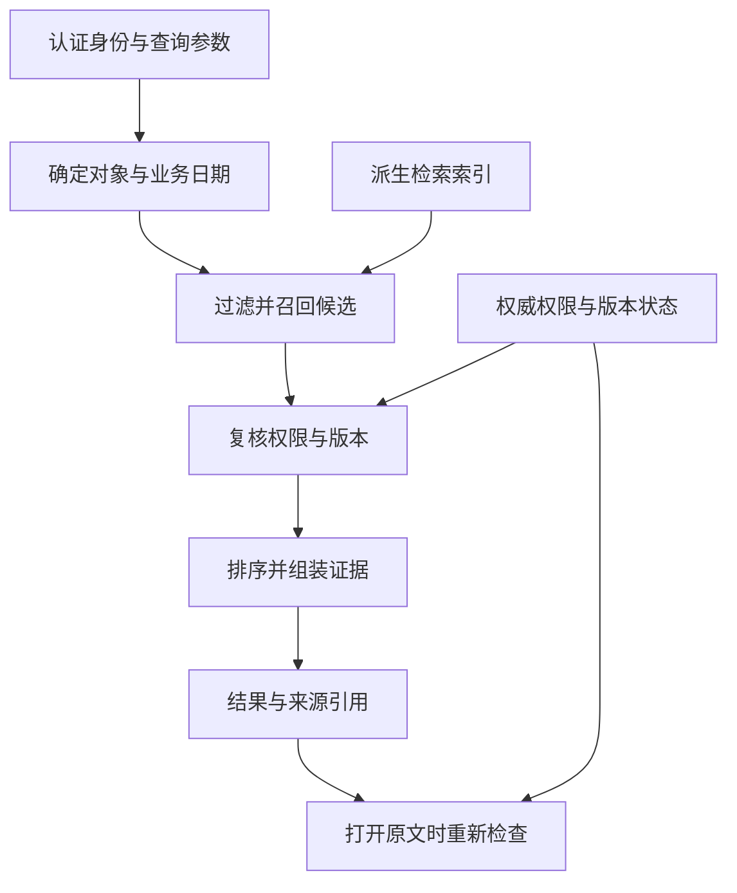

# 01｜企业知识库如何判定一条搜索结果可以交付？

**企业级知识库设计与检索质量工程 · 第一阶段**  
阅读约 25–30 分钟 · 可选回放约 10 分钟 · 案例使用合成语料

员工换了手机，旧手机还在手边。她搜「更换手机后怎么重新绑定登录验证（MFA）？」。第一条结果几乎复述了她的问题，操作写得也很明确：向服务台提交「MFA 重置」工单。这个流程在 10 月 1 日已经停用。她现在应从账号中心迁移验证器，而现行指引排在第二。

假设你负责这个搜索服务。给新页面加一点分，可以让这一次搜索看起来恢复正常。下一个问题是，客服要复核 9 月 30 日发生的工单，当时恰好应该使用旧流程。要让这两个查询都成立，系统需要表达什么？谁决定某个版本能参与搜索？如果索引里还是旧记录，哪一层能在交付前拦住它？

本期从这三个问题推导搜索契约、数据模型和请求路径。读完后，你应该能为同一查询设计随身份、对象、日期变化的结果，解释为什么索引里需要保留旧版，并把关键承诺写成验收用例。

## 一、先定义搜索要兑现什么

同一批候选里，三份材料各有用处。实验把查询时间固定在 2026-11-18，提问者和业务对象均为普通员工。

| 原始排名 | 原文证据 | 能支持的内容 | 当日状态 |
| ---: | --- | --- | --- |
| 1 | `mfa-rebind-v1#steps` | 向服务台提交「MFA 重置」工单，等待清除旧设备 | 已失效 |
| 2 | `mfa-rebind-v2#steps` | 旧手机可用时，从「账号中心 → 安全设置 → 验证器迁移」扫码添加新手机 | 当前有效 |
| 3 | `mfa-faq-v1#why` | 解释第二步登录验证的目的 | 当前有效，可作为背景阅读 |

**文档命中**说明页面内容与问题有关。**证据命中**要求定位到能支持某项具体动作或结论的原文段落。一个页面可能同时包含「旧手机还能使用」和「旧手机遗失」两节。命中页面时，这两种用户仍需要不同操作。再加上企业制度和访问权限，系统要分别判断四件事。

| 判定 | 在回答什么 | 依据 | 对结果的作用 |
| --- | --- | --- | --- |
| 可读 | 谁能看到这份资料？ | 服务端认证身份、组成员关系、资源权限 | 决定是否可以展示标题、片段或原文 |
| 适用 | 这套规定覆盖问题所指的谁与什么条件？ | 员工或外包、所属地区／项目、设备状态等条件 | 对象明确时筛出不相干的制度；条件未知时保留条件说明或要求澄清 |
| 有效 | 哪一天可以依据这份版本办事？ | 发布状态、业务生效与失效日期 | 决定版本能否作为指定日期的依据 |
| 相关 | 这段原文对眼前的问题有多大帮助？ | 文档主题、查询词及段落语义 | 决定可交付候选的顺序；也帮助区分背景与操作证据 |

这四项决定搜索服务能给出的承诺。**高分代表相关，读取权和制度资格由独立规则决定。** 本期的搜索页可显示有用的背景资料。后续问答服务需要更进一步，逐项检查作为引用的段落能否支持答案的主张。

### 设计请求上下文

员工替外包同事查询时，访问权限由提问者决定，办理流程由外包身份决定。日期还会改变适用的制度版本。因此，先把**谁在问、为谁问、查哪天**建模为三个字段，再由检索服务组合条件。搜索词单独传给检索函数。

配套实现的查询范围叫 `Scope`。HTTP 层用本地演示凭证确定身份夹具，校验业务日期后，由 `app/search.ts` 把输入装成同一个查询范围。

```ts
export function scopeFor(fixture: PrincipalFixture, asOf = FIXTURE_TODAY, subject?: Subject): Scope {
  const principal = PRINCIPALS[fixture];
  return { principal, subject: subject ?? principal.subject, asOf };
}
```

例如 `scopeFor('employee', '2026-11-18', 'contractor')` 会保留员工的 `principal`，把业务对象置为 `contractor`。如果省略 `subject`，就使用提问者的默认业务对象。访问权限继续按当前提问者判断。产品如果从自然语言提取到「外包同事」，可在检索前确认业务对象；歧义会改变办理入口时，可以向用户澄清，或同时展示各自有明确条件的入口。

读者可以先盖住下面的预期列，逐行推导。

| 提问者 | 业务对象 | 业务日期 | 预期证据 |
| --- | --- | --- | --- |
| 普通员工 | 员工 | 2026-09-30 | `mfa-rebind-v1#steps`，当时应走工单旧流程 |
| 同一员工 | 员工 | 2026-10-01 | `mfa-rebind-v2#steps`，切换日开始自行迁移 |
| 同一员工 | 外包 | 2026-11-18 | `mfa-contractor-v1#steps`，由项目负责人提申请 |
| 普通员工查 `KB-4032` | 员工 | 2026-11-18 | 可见的员工自助指引；管理员手册的标题、正文和引用均不可交付 |
| IT 管理员查 `KB-4032` | 员工 | 2026-11-18 | 可纳入管理员处置原文；具体顺序由查询与排序决定 |

第三行给的是**正确证据**。首期回放中它仍可能排在通用 FAQ 后面，这是排序问题。最后两行同时验证权限和业务对象的独立性。管理手册即使描述的是员工账号，普通员工也没有阅读权限。同样的分法可以用于 HR 的员工休假指引和项目组内的 Atlas 联调手册。

## 二、从问题推导四个数据对象

假设现行指南改名了，知识库需要保留原来的收藏关系。再假设指南新增一个针对旧设备遗失的流程，审计人员仍须打开更早那次搜索实际引用的段落。第三个变化是搜索团队把一个段落拆成两个片段，以便命中错误码。三个变化的影响范围各不相同。

| 对象 | 例子或关键字段 | 何时改变 | 谁依赖它 |
| --- | --- | --- | --- |
| 文档 `Document` | `document_id=mfa-rebind`、源系统、源记录 ID、归属部门 | 新建独立文档时分配 ID，改名或移动时保留 | 去重、归属、来源同步 |
| 文档版本 `DocumentVersion` | `version_id=mfa-rebind-v2`、内容指纹、发布状态、有效区间、适用范围 | 步骤、条款或需要保留快照的变更发布时生成 | 当前与历史检索、审计、判定业务适用性 |
| 原文证据 `EvidenceSpan` | `mfa-rebind-v2#steps`、段落定位和原文 | 同一不可变版本内锚点保持稳定，新版本以自己的 ID 定位 | 引用、人工标注、诊断 |
| 索引片段 `IndexedChunk` | 片段 ID、索引代次、对应证据范围、分词或向量字段 | 切片、索引或检索配置重建时可替换 | 召回、融合、排序、索引切换 |

如果一个片段覆盖表头、表格行和一段注释，记录它引用的证据范围。搜索接口交付的是版本和原文引用，评测也给证据打标。第 04 期比较切片方案时，新旧索引仍可用同一套标注比较。来源链接最好定位到带版本的原文快照；只有可变 Wiki URL 的来源，需要保留快照才能复核搜索当时引用的文字。

### 版本字段要表达业务生效日

首期采用上海自然日，区间为 `[valid_from, valid_until)`。失效日当天开始应用后续规则。

| 版本 | 发布状态 | 生效日 | 失效日 | 2026-11-18 查询 |
| --- | --- | --- | --- | --- |
| V1 | 已发布 | 2026-01-01 | 2026-10-01 | 已失效 |
| V2 | 已发布 | 2026-10-01 | 开放上界 | 有效 |
| V3 | 草案 | 2026-11-01 | 开放上界 | 待发布 |
| V4 | 已发布 | 2026-12-01 | 开放上界 | 待生效 |

表格对应教学语料。现实中如果 V4 在同一适用范围替换 V2，发布流程要把 V2 的失效日和 V4 的生效日设到同一边界，并检查两版的区间重叠。若是员工版和外包版分别生效，两版可以并存；部分范围重叠时需要显式优先规则或人工确认。建议在发布入口阻止无解释的重叠，遇到共同适用且权威级别无法判定的版本时，将冲突保留给用户核验。

### 用半开区间决定版本资格

切换日只有一套流程应该生效。若旧版和新版都包含当天，搜索会拿到两份同时适用的办理指引。使用左闭右开区间后，版本到达生效日即开始适用，到达失效日即结束。草案即使填了业务日期，也要等发布通过。

下面摘自 `app/search.ts`。输入是当前候选版本和已构造的查询范围。输出区分未发布、待生效、已失效和有效，供检索路径决定候选是否继续。

```ts
export function versionAvailability(version: Version, scope: Scope) {
  if (version.status !== 'published') return 'unpublished';
  if (scope.asOf < version.valid_from) return 'future';
  if (version.valid_until !== null && scope.asOf >= version.valid_until) return 'expired';
  return 'valid';
}
```

顺着代码看 10 月 1 日。V1 的 `asOf` 等于 `valid_until`，第三个判断返回 `expired`。V2 的 `asOf` 等于 `valid_from`，第二个判断不成立，走到 `valid`。这里的字符串比较依赖统一的 `YYYY-MM-DD` 格式及业务时区；HTTP 层先校验查询日期，版本日期由语料提供。`valid_until = null` 表示尚无结束日期。

生效日、发布状态或适用范围缺失时，应有明确的导入处理。可以先把材料送待审队列，记录原文和责任人，暂缓纳入操作类证据。对于已确认可读、且获准作为背景资料展示的内容，可以保留结果并标示其状态。草案空间若有独立阅读权限，可以提供独立入口。

### 追溯生效需要第二条时间线

假设 HR 在 11 月 18 日补录规则，并规定从 10 月 1 日起生效。两类历史问题会同时出现。

| 要回答的问题 | 查询所需时间 |
| --- | --- |
| 根据现在掌握的资料，10 月 15 日适用什么规则？ | 业务有效时间取 10 月 15 日；使用当前已登记的资料 |
| 10 月 15 日上午，系统当时依据什么资料做决定？ | 同时保存业务有效时间和系统记录时间，重建当时已知的版本 |

第一类以 `asOf` 表达。第二类可增加独立的 `knownAt`，并保存当时各条版本断言的系统记录区间或变化事件。若要求还原「当时用户实际能搜到什么」，还需要索引可见时间和当时的索引代次或查询记录。它们分别描述政策何时适用、系统何时得知、搜索何时可见。当前实验只实现业务日期查询。 [Martin Fowler：Bitemporal History](https://martinfowler.com/articles/bitemporal-history.html)

另一个边界是员工询问「下周」时，届时可能同时有待生效规则与缺失材料。若服务支持未来计划，显式展示查的是「计划生效」并标明依据，避免用户把它用于当天操作。本期教学接口只接受实验查询日及更早的日期。

## 三、沿一次请求划分组件职责

权威服务持有版本和权限。搜索索引从这两类数据派生过滤字段，再建立可检索的片段。用索引条件缩小候选池，随后在可信服务内批量复核。只有通过复核的段落，才能进入摘要、外部重排或响应。



1. **召回阶段尽量排除不合格结果。** 假设全局只取前 10 条，其中 9 条来自已失效版本。即使交付前把它们全删掉，排在第 11 条以后且合格的材料也没有机会进入这次结果。可以把状态、有效日期和可见范围纳入索引过滤条件，保留候选预算给合格材料。过滤会怎样影响召回，需要在选定引擎上衡量。 [OpenSearch 向量过滤方式](https://docs.opensearch.org/latest/vector-search/filter-search-knn/index/)
2. **复核阶段使用权威状态。** 假设管理员撤回了手册权限，搜索索引还有旧组信息。下一次查询即使召回旧记录，批量复核也应剔除相关候选。权威状态不可用时，暂缓交付无法确认权限或版本资格的结果。诊断记录保留丢弃数量、索引代次和失败类型，业务响应只暴露已获准的内容。
3. **来源页与搜索页共享读取约束。** 搜索页给出 `version_id` 和原文锚点。用户打开来源时，服务端重新检查访问对象、请求身份与业务日期；同一个链接转发给其他人，按接收者自身权限判断。直接访问来源接口也执行对象级授权。 [OWASP API Security：对象级授权](https://api-security.owasp.org/editions/2023/en/0xa1-broken-object-level-authorization/)

复核会过滤假阳性，却无法补回索引从未召回的证据。权限新授予后仍搜不到，可以观察索引更新滞后；这和撤权后继续输出本应受限的内容有不同的优先级。若允许把复核后结果放进缓存，命中缓存的请求也要满足当前权限约束。对已经在途的请求，另行定义权限承诺的判定点；本例以交付前复核时已提交的权限为准。第 10–12 期会展开策略版本、缓存键和失效策略。

### 在评分前筛掉无资格的候选

搜索的评分函数只需要比较相关性。读取权、业务范围和版本状态决定一个候选能否进入评分。下面是 `app/search.ts` 循环内的筛选逻辑，后续才会匹配标题和段落。

```ts
if (!canRead(version, scope) || !appliesTo(version, scope)) continue;
const availability = versionAvailability(version, scope);
if (availability === 'unpublished' || availability === 'future') continue;
if (availability === 'expired' && !options.omitExpiryForReplay) {
  rejectedExpired.push(version.version_id);
  continue;
}
```

`canRead` 按提问者身份判断，`appliesTo` 按业务对象判断。随后调用同一个版本函数。过期 ID 供本地回放解释候选去向。`omitExpiryForReplay` 只在 A 组实验开关中使用，正常 HTTP 搜索调用采用默认行为，过滤失效版本。这样才能固定资料和打分函数，只改变一条逻辑验证根因。

### 用户打开来源时再检查一次

来源链接可能被复制，资源的授权也可能变化。绑定版本和锚点能定位证据，打开该地址的请求还需要独立通过读取检查。下面是 `app/api.ts` 中生成原文页面之前的逻辑。

```ts
const version = corpus.find(({ version_id }) => version_id === request.params.versionId);
if (
  !version
  || !canRead(version, scope)
  || !appliesTo(version, scope)
  || versionAvailability(version, scope) !== 'valid'
) {
  return reply.code(404).send({ error: 'source_unavailable' });
}
```

例如普通员工打开管理员手册地址，即使版本仍有效，读取检查也会返回统一的 `404 source_unavailable`。在配套回放中，搜索和来源页使用同一份内存快照及相同规则。独立权威服务、陈旧索引和外部重排在上图中作为生产设计示例，本期实验验证版本区间和本地读取边界。

## 四、从场景选择版本存储和搜索方式

| 设计 | 适合什么条件 | 需要付出的维护成本 | 什么时候重新考虑 |
| --- | --- | --- | --- |
| 所有版本在一个索引，查询按日期过滤 | 当前与历史搜索希望共用入口，能控制版本增长 | 所有版本维护统一字段与权限投影；验证在常见日期和团队规模下的过滤效果 | 历史资料显著增加索引体积，或归档查询和保留策略有独立要求 |
| 现行索引与历史归档分开，按意图路由 | 大部分业务查当前规则，历史由审计或客服按需查询 | 维护两套更新与路由，约定切换边界、同一版本的来源定位和历史入口权限 | 跨日期查询开始普遍，或新旧索引频繁不同步 |
| 在有资格的候选内加新鲜度信号 | 多份有效资料同时存在，用户通常更关心新指引或发布公告 | 需要按文档类型设置规则，验证长期有效的权威资料仍能排到前面 | 短期公告反复压过正式制度，或强时效性只适用于一小类查询 |

前两项是索引与路由决策，第三项是可以配合使用的排序决策。当前场景只有 22 个文档版本，要支持当前和历史两类查询，先共用版本库并按日期筛选即可。若后续必须保留多年的历史资料，先用实际版本量、当前查询比例和延迟判断是否值得拆分，确认来源链接仍能定位各版本再切换。

若要写一页架构决策记录，最少留四项信息。

| 项目 | 本例可填写的内容 |
| --- | --- |
| 条件 | 员工常查当前流程，客服偶尔复核历史工单，制度按自然日生效 |
| 决策 | 统一保存版本；当前查询使用服务时钟，显式历史查询按给定业务日期检索 |
| 保证 | 查 9 月 30 日可引用 V1，查 10 月 1 日只能以 V2 为员工换机依据；撤权后的来源请求必须重新判定 |
| 复审条件 | 归档保留策略独立、版本规模推高当前查询延迟，或需要重建系统在特定时间实际掌握的资料 |

## 五、把相似的失败拆开处理

过期指引排第一、FAQ 排第一和口语查询空页都可能被用户概括为「搜错了」。要确认第一处失败发生的位置，可以沿着原文、资格、候选和结果依次查。

| 表现 | 一条区分证据 | 第一处应查的环节 | 一种落地处理 |
| --- | --- | --- | --- |
| 原文有操作步骤，搜索数据只有标题 | 导入结果缺少原文锚点或步骤文本 | 解析或切片 | 保留结构节点并回补索引；用原文定位验收 |
| 过期步骤排第一，现行步骤已在候选中 | 同一请求中旧版得 16 分，日期资格为失效 | 候选资格 | 补上失效日期上界，验证切换日与历史模式 |
| FAQ 排在外包办理步骤前 | 两条均可读且日期有效，正确操作段落排名靠后 | 排序 | 增加流程类字段／段落类型信号，按问题类型回归 |
| 「换了个新机，网页还让我用原来的机子点同意」没有搜索结果 | 正确段落存在且合格，词法候选为空 | 召回 | 比较同义词、词法分析或语义召回，保留原证据标注 |
| 搜索结果有引用，打开却显示了别的版本 | 搜索项带 V1 引用，来源地址跳转到了可变页面的最新版 | 交付或来源定位 | 通过不可变的版本快照和段落锚点定位 |
| 授权已变更，缓存或索引仍命中旧权限 | 权威权限拒绝，请求中仍出现受限标题或摘要 | 交付复核 | 除搜索正文外，对来源页、摘要和下游调用都检查当前授权 |

样例排序用 `3 × 标题命中词数 + 段落命中词数`。旧版标题命中四项，正文也命中四项，总分 16；现行版命中一项标题和四项正文，总分 7。两段文本的匹配分可以同时成立。修复的因果证据在于：**同一规则、同一语料，补上 `valid_until` 后，旧版退出候选，原来已被召回的现行段落排到首位。**

### 验收时分别检查系统约束与排序质量

| 想验证的承诺 | 最小用例 | 可检查的结果 |
| --- | --- | --- |
| 切换日正确 | 按同一身份、同一查询，分别查切换日前一天与当天 | 分别返回 V1 和 V2 对应步骤 |
| 业务对象和读取身份独立 | 同一员工为自己查、为外包同事查，再直读管理员手册 | 可适用的操作证据随业务对象变化，受限手册始终按提问者身份判定 |
| 始终可核验引用 | 打开结果返回的版本和锚点 | 原文能定位到搜索显示的段落；相同地址交给无读取权限的身份时不可读 |
| 改进了有用结果排序 | 固定正例以及证据标注，对比首条命中和 Recall@10 | 判断正确证据原本在候选里，还是这次新增召回 |

现有 20 条合成场景分成 18 条有证据正例和 2 条预期空页。补上失效上界后，首条命中从 **11/18 升到 13/18**，无效版本返回项从 **2 降到 0**，Recall@10 保持 **0.889**。两种配置都在前十找到 16 条正例的证据，改动改善了两条查询的首位结果。外包办理的排序问题和两条口语改写的漏召回仍保留在报告里，后续可用同一批标注检验。实验只覆盖这组语料。 [NIST TREC：固定查询与相关性标注](https://trec.nist.gov/overview.html)

## 六、复盘与可选回放

先写预期，再看答案。

1. **边界题。** 同一流程的 V1 在 10 月 1 日失效，V2 从当天生效。后台抓取时间都显示 10 月 2 日，怎么判定 10 月 1 日的查询？  
   **推演。** 对同一适用范围，按版本业务日期筛选得到 V2。如果问题改成「当时系统检索到了什么」，另查索引可见时间或查询记录。
2. **架构题。** 搜索只从引擎取前 10 条，再根据现有权限去掉不可见结果。某个项目成员拿到的结果只有 1 条，如何分别处理质量与安全？  
   **推演。** 质量上先看候选池是否被不合格项占满，尽量把过滤条件推到召回，必要时扩大合格候选预算。交付前继续按权威权限复核，并检查标题、片段和来源页都遵守相同规则。
3. **设计迁移题。** Atlas 有一份成员可读的联调手册和一份全员可见的账号申请指南。员工代外包同事查「第一天要办什么」，怎样写第一条验收用例？  
   **推演。** 固定业务对象是同一个外包同事，分别以普通员工和 Atlas 成员查询。两人都可以看到适用的账号申请证据。项目手册中适用的联调信息只进入成员结果。两条请求沿用相同的业务日期，并分别验证来源链接。

可选回放只看一个差异。按配套 README 安装依赖后，运行 `npm run --silent replay -- --case it-01`，对照两组候选的位置和失效记录。源码、启动命令和 20 条逐项报告在 [第一期实操包](../projects/week-01/README.md)。

下一期，我们沿着原文引用往上游追。面对散落在共享盘、Wiki 和员工手里的资料，先设计如何盘点知识源、接收文件并留存原件，再判断重传、改名或换路径究竟是不是同一次导入。第 03–05 期继续讲识别与清洗、证据切片、入库与发布。 [全季大纲](../enterprise-knowledge-base-series-outline.md)
