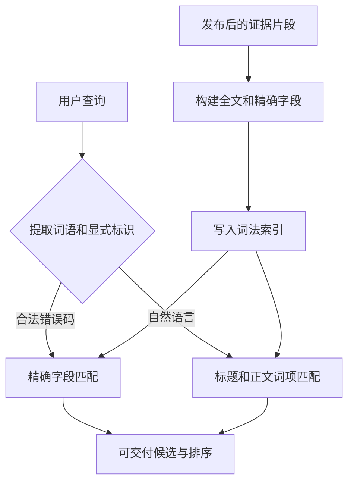

# 06｜错误码为什么搜不到？从 BM25 建立词法基线

**企业级知识库设计与检索质量工程 · 第二阶段**  
阅读约 30 分钟 · 可选练习约 10 分钟 · Atlas 数据和手算样例均为合成数据

| 读前要点 | 本篇内容 |
| --- | --- |
| **设计主线** | 把「文本怎样拆成词」「哪些条目能进入候选」「命中后怎样打分」分开，建立可解释的词法基线。 |
| **边界场景** | 中英文混排、连字符和全角字符、相近错误码、缩写重名、长正文与标题过强。 |
| **方案示例** | 让错误码使用专用精确字段，标题与证据正文使用全文字段。手算一组 BM25 分数，再用字段和词项证据解释坏例。 |
| **验收** | 能说明 `KB-4032` 怎样入索引、怎样识别为查询中的精确值；能区分分词失败、未进入候选和排序靠后三种问题。 |

Atlas 入场人员打开账号申请页面，看到 `KB-4032`。他搜索「Atlas 入场 KB-4032 怎么处理」。排在第一的是一份全量错误码手册，标题恰好含有这串字符；真正写着「重新选择项目，补填用工类型」的短证据沉在后面。另一名员工把同一串错误码从表格复制过来，里面是全角数字，查询又变成了空页。

这两种现象都不能只靠改标题权重处理。上一期完成了入库发布。现在要确定**发布到词法索引的字段**，并让每一次匹配有迹可循。

## 一、索引与查询怎样在词项上相遇

词法搜索对可匹配的词项建立索引。索引时，分析器决定原文留下哪些词项；查询时，系统也需要明确怎样表达用户输入。两边使用的表示要能衔接，排序才有机会发挥作用。



一句话可以走两条匹配路径。`KB-4032` 从明确的格式中抽取出来，规范化后匹配错误码字段。余下的「Atlas 入场」「怎么处理」继续进入全文匹配，用来识别具体业务场景和操作证据。访问授权、适用人群和业务日期是候选资格。它们应尽可能参与召回，并在交付时按权威状态复核。第 01 期的过期指引仍适合作为回归用例。

如果索引没有正确收录某个词项，即使 BM25 的参数调得再细，候选也不会凭空出现。可用 Analyze API 对同一个索引映射，分别检查字段和查询文本实际产生的词项。 [OpenSearch Analyze API](https://docs.opensearch.org/latest/api-reference/analyze-apis/)

## 二、给精确值、全文和业务约束各自的字段

| 字段 | 建议类型 | 如何写入和查询 |
| --- | --- | --- |
| `document_version_id`、`evidence_id` | `keyword` | 指向文档版本与证据。结果回原文和评测去重使用。 |
| `title`、`section_path_text` | `text` | 对标题和章节路径分词。标题可适度加权，再用正文证据和业务范围检查坏例。 |
| `evidence_text` | `text` | 写入第 04 期生成的证据正文，表格保留列名和适用条件。用它衡量候选是否真的写了操作。 |
| `error_codes` | 多值 `keyword` | 抽取规范形式，如 `KB-4032`。写入和查询使用同一版规范化规则。 |
| `product_key`、`audience_keys` | `keyword` | 明确已识别的产品、适用对象。结合权限和业务规则过滤；保留原始来源供核对。 |
| `valid_from`、`valid_until` | 日期或业务日字段 | 执行第 01 期的半开有效期规则；无结束日期按明确的开放上界处理。 |
| `source_ref`、`index_generation` | 来源结构、代次标识 | 解释命中来自哪个源块和哪一代索引。 |

`keyword` 字段适合承载整值匹配。把错误码抽到专用字段后，编号不与普通正文共用同一套切词规则；原件继续保留原写法。 [OpenSearch Keyword 字段](https://docs.opensearch.org/latest/mappings/supported-field-types/keyword/)

给错误码写一份**可验证的规范化约定**。例如接受全角数字、英文字母大小写变体，以及列在允许清单中的连字符写法，输出 `KB-4032`。保留原值与规范化版本。对 `KB-40320`、`KB-4033`、`KB-40?2` 做负例；被识别为疑似但格式不完整的编号，可以提示核查或进入普通文本查找。若两条产品线都使用 `KB-4032`，用产品范围区分，产品未确认时保留多个已授权候选。

最小查询策略可以写成五行。

```text
scope    ← 已确认产品、适用对象、业务日期与可读范围
code     ← 按允许格式从查询中解析的错误码
exact    ← 有 code 时在 error_codes 上找精确命中
fulltext ← 用标题、章节和证据正文匹配查询
result   ← 在 scope 内组合两类候选，优先给已验证的操作证据
```

如果明确输入了错误码，精确命中的正确处置片段应优先于只包含近似编号的说明。错误码命中了多条证据时，仍需按产品、流程和原文作用选出最适用的一条。

## 三、BM25 如何给已经匹配的正文打分

BM25 为命中的词项建立相关性分数。这里用一个教学形式理解三个因素。

- **词频**。词项重复出现会提高贡献，但收益逐渐变小。
- **逆文档频率**。某个词在索引里越普遍，它区分文档的能力通常越弱。
- **长度归一化**。用字段长度和整体平均长度调节词频贡献。同样出现次数意味着不同的文本密度。

用单个词项 `门禁` 手算。假定该字段有 100 个文档，5 个包含它，平均长度为 100 个词项，取 `k1=1.2`、`b=0.75`。教学公式以 `f` 表示词频、`dl` 表示当前字段长度。

```text
IDF = ln(1 + (N - df + 0.5) / (df + 0.5))
词频贡献 = f × (k1 + 1) / (f + k1 × (1 - b + b × dl / avgdl))
单词项分数 = IDF × 词频贡献
```

| 候选 | 词频 | 字段长度 | 词频贡献 | 教学分数 |
| --- | ---: | ---: | ---: | ---: |
| A · 门禁快速处理 | 1 | 50 | 1.2571 | 3.6588 |
| B · 综合支持手册 | 3 | 200 | 1.2941 | 3.7664 |
| C · 入场门禁规定 | 2 | 100 | 1.3750 | 4.0018 |

B 提到三次，分数仍低于 C。表中只比较一个字段和一个词。真实查询的分数还随分析器、字段组合、权重和引擎实现变化。给读者解释排序时，用教学计算理解方向，用目标索引的 Explain 结果核对实际得分。 [OpenSearch Explain API](https://docs.opensearch.org/latest/api-reference/search-apis/explain/)

## 四、按顺序定位搜不到与排错的问题

| 看见的结果 | 优先读取的证据 | 处理方案 |
| --- | --- | --- |
| `KB-4032` 为空 | 来源片段、`error_codes` 的实际值、查询解析结果 | 纠正抽取、字符规范化或字段映射，再重建受影响索引。 |
| 命中 `KB-40320` 或另一个产品 | 查询路径、是否走了精确字段、产品范围 | 建立专用错误码字段与产品过滤，保留近似编号作为负例。 |
| 综合手册排第一，正文没有可执行步骤 | Explain 的标题与正文贡献，以及候选的原文证据 | 调整标题权重，尝试检索独立证据段，并检查长短文档结果。 |
| 正确条目在过滤前存在、过滤后消失 | 业务有效日期、适用对象和权限判断 | 查明是应有的排除，还是来源标签或版本登记错误。 |
| 口语「新来的同事进大门找谁」查不到门禁 | 分词结果、同义词覆盖以及候选深度 | 记录词法缺口；用同一批证据标注验证第 07 期的向量方案。 |

避免从一次错误就直接调整全局分词器。先保存一条失败查询、它的资格范围和预期证据，再保留分析器输出、实际候选和得分解释。复现时固定索引代次和字典版本，能判断是哪一层的改动生效。

### 一条错误码查询的最小诊断记录

对「Atlas 入场 KB－４０３２ 怎么处理」，先冻结查询和已解析的产品、身份等条件。HTTP 层记录的词项可来自一次受控诊断，生产日志只保留允许采集的字段。

| 诊断字段 | 示例中的预期 | 能排除什么 |
| --- | --- | --- |
| `parsed_code` | `KB-4032` | 复制来的全角数字没有把同一编号变成另一类查询。 |
| `matched_field` | `error_codes` | 确认错误码走了整值匹配路径。 |
| `evidence_id` | E4 · 该错误码现行操作说明 | 区分只列编号的目录页和可执行步骤。 |
| `eligibility` 与 `rank` | 合格；按本次重放保存 | 合格证据已命中却排在后面时，优先检查排序。 |

一次有用的调参对比只改变一个环节。例如先固定切分和字段，仅调整标题权重；如果正确证据原本没有进入候选，就保留这一事实并转查匹配字段。

## 五、接受一条可复查的基线

用三组查询验收。**精确标识组**包含原写法、允许变体、近似编号和产品内重名；**文档证据组**比较长标题与实际操作段；**口语组**保留词法确实漏掉的表达，供后续混合召回对照。另放入一条旧版和一条无权读取的手册，检查它们是否绕过候选资格。

每条验收记录写明 `query`、`scope`、`expected_evidence_id`、实际词项、命中字段和排序结果。离线手算验证了本篇的公式示例；引擎行为需要在读者自己的索引上用 Analyze、Explain 和查询回放核对。

**可选练习。** 解释为什么候选 B 多出现一次仍落后于 C。再设计三个输入，让 `KB－４０３２` 和 `KB-4032` 归到同一规范值，而 `KB-40320` 保持独立。最后写下一条词法基线仍无法命中的口语问法。下一期会用它检验向量召回的实际增量。
