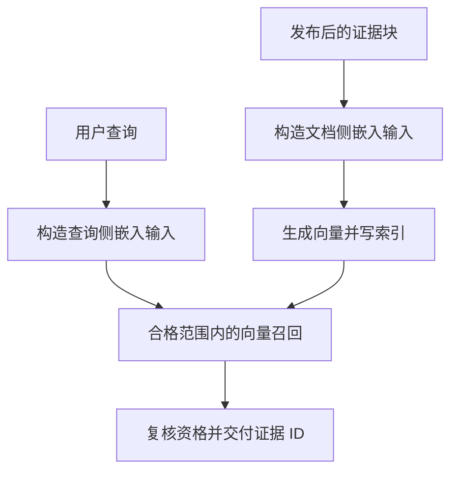

# 07｜向量找到了意思相近的文档，为什么还是没用？

**企业级知识库设计与检索质量工程 · 第二阶段**  
阅读约 30–35 分钟 · 可选练习约 10 分钟 · Atlas 数据与示意向量均为合成数据

| 读前要点 | 本篇内容 |
| --- | --- |
| **设计主线** | 分开设计 Embedding 输入、相似度计算和向量索引，用精确搜索给近似搜索建立参照。 |
| **边界场景** | 口语同义、精确编号和数值、跨部门同名概念、业务规则不适用、切片过短，以及不同向量版本混用。 |
| **方案示例** | 在同一证据集上运行词法和向量两条路线，设计嵌入配置、输入指纹、批量重试与索引切换。 |
| **验收** | 对口语、错误码和权限场景分别给出期望结果，区分语义排序问题、近似搜索漏召回和候选资格问题。 |

Atlas 入场人问「刚来第一天进大门，应该让谁替我办？」词法路线主要匹配到「第一天」。向量路线找到「门禁」，却把一条给正式员工的办卡说明排到了外包首日规定前。系统进一步从「完全找不到」走到了「找到了类似的东西」，还差一步才有答案。

第 06 期建立了可用的词法基线。现在引入向量，先明确它能补哪些查询，再决定哪些内容可以进入向量索引、如何解释它找到的候选。

## 一、一条口语查询会经过三层处理

Embedding 模型把文本表示为向量。相似度函数给两条向量的接近程度打分。向量索引帮助系统从很多候选中找近邻。三个环节分别决定**表示、排序和查找成本**。Embedding 可以帮助查到用词不同但含义接近的证据。 [OpenAI Embedding 指南](https://platform.openai.com/docs/guides/embeddings)



文档侧可以把标题、章节、条件和正文组合成一个稳定模板。对门禁表来说，「区域｜办理人｜适用条件」应跟行值一起进入模板。查询侧按模型约定处理短句，保留用来筛选的产品、日期和业务对象。部分模型或任务要求对查询和文档使用指定前缀或不同任务参数，按供应商文档固定配置。索引侧与查询侧应按照已验证的配对配置工作。

有效期、适用对象和读取权限仍是独立规则。一条过期的指南可能非常相似，一条受限的项目手册也可能最接近问题。应在支持的引擎配置里尽早施加资格条件，再由服务以权威状态复核。若只取全局近邻后才过滤，候选数可能下降；这时记录过滤前后的深度与有效候选覆盖率。 [OpenSearch 向量过滤方式](https://docs.opensearch.org/latest/vector-search/filter-search-knn/index/)

## 二、先设计嵌入输入，再选择向量配置

| 输入项 | 写入示例 | 设计理由 |
| --- | --- | --- |
| 业务标题 | Atlas 外包入场／首日门禁 | 给短片段补主题，区分设施门禁和系统访问权限。 |
| 证据正文 | 区域、办理人、适用对象和首日条件 | 保留用户真正要查的事实，降低只靠标题召回的概率。 |
| 精确标识 | `KB-4032`、项目代号 | 可随原文保留；精确等值条件继续由第 06 期字段处理。 |
| 结构化约束 | 适用对象、版本与时间、资源访问标签 | 作为过滤或复核信息。关键制度约束可以同时保留在原文字段中，便于理解与引用。 |
| 来源和原文位置 | `atlas-ingress-v3#badge` | 支持验收和回到原文。内部定位 ID 通常无需加入给模型生成向量的文本。 |

输入模板可从「标题 + 小节 + 条件 + 正文」起步。对超长证据，记录当前模板的长度预算和截断策略，优先让直接约束执行的条件随证据保留。把「谁能读」和「哪些内容允许发送给 Embedding 服务」分开确认。托管服务的输入沿用组织批准的处理范围；数据隔离、保留策略和供应商条款由接入方确定。

改变模板、模型版本、向量维度或归一化方式，都可能改变结果。即使两个模型输出维度相同，也要用同一已验证的向量空间进行比较。需要记录配置身份，便于索引和请求路由配对。

## 三、精确搜索与 ANN 怎么分别验收

用二维向量理解余弦相似度。示例所有向量都已归一化，余弦相似度等于点积。给查询向量 `q = (1, 0)`，每个分数就是候选向量的第一维。数字用于手算，不代表实际模型效果。

| 证据 | 示例向量 | 余弦相似度 | 与问题的关系 |
| --- | --- | ---: | --- |
| E1 · 外包首日门禁规定 | (0.80, 0.60) | 0.80 | 操作证据，写明项目负责人提交 |
| E3 · 园区开放时间 FAQ | (0.96, 0.28) | 0.96 | 与进出园区相似，未回答谁提交 |
| E4 · 账号错误码处理 | (0, 1) | 0.00 | 属于另一个问题 |
| E5 · Atlas 内部运行手册 | (1, 0) | 1.00 | 本次提问身份无权读，排除 |

对**同一合格范围**穷举相似度，精确 Top 2 是 `[E3, E1]`。如果近似搜索（ANN）返回 `[E3, E4]`，相对精确结果的 Top 2 邻居覆盖率是 1/2。这里可以分别观察两类质量。

| 要检查什么 | 参照答案 | 此例暴露的问题 |
| --- | --- | --- |
| 向量表示是否能把正确证据排在前面 | 人工标注 E1 是正确办理证据 | 精确向量搜索也把 FAQ 排在 E1 前。需要改输入、模型或后续排序。 |
| ANN 是否接近这份向量空间的精确查找 | 过滤范围相同的精确 Top K | E1 在精确 Top 2 却未被 ANN 找到。需要检查索引参数、过滤方式与候选预算。 |

做 ANN 评估时，小样本可穷举打分，固定使用相同向量、距离度量、资格范围和并列规则。再逐项观察候选规模、邻居覆盖率、延迟与资源占用。ANN 搜索的实现和参数因引擎及索引配置而异。 [OpenSearch 近似 k-NN 搜索](https://docs.opensearch.org/latest/vector-search/vector-search-techniques/approximate-knn/)

## 四、向量索引应该记录哪些字段

| 字段 | 用途与约束 |
| --- | --- |
| `evidence_id`、`document_version_id` | 回到证据与原件；知道哪些向量属于同一文档版本。 |
| `embedding_profile_id` | 标记模型、版本、输入模板、维度、预处理、度量和查询侧配对配置。 |
| `input_hash` | 对规范化后的嵌入输入求指纹。判断相同配置下是否可复用既有向量，或需要重算。 |
| `index_generation` | 区分当前读写目标和新构建目标。用于对照、切换和回滚。 |
| `vector_status`、`last_error` | 区分待生成、失败、已写入与可见性已验证。内部状态服务于补跑和发布。 |
| `eligibility_ref` 或资格投影字段 | 绑定上游批准的版本与资源授权；查询时用权威信息复核。 |

首版可以把 `evidence_id + embedding_profile_id + input_hash` 作为同一隔离范围内生成向量的稳定键，写索引时再绑定目标代次。批次中某一项超时，只重试失败项；收到旧配置任务时，仍可保存诊断信息，但结果只能落在它被授权的目标代次。更新访问标签通常可独立于重新生成文本向量，前提是内容输入没有变化，并且能确保过滤及交付遵守当前策略。

### 一次模型升级怎样切换

1. 固定原件版本和评测证据，创建新嵌入配置及索引代次。
2. 批量生成并写入向量，核对每个证据、维度、配置和读路径，跟踪失败项。
3. 在同一授权范围运行旧、新两份索引，比较精确和 ANN 结果，以及错误码、口语、政策三类人工标注。
4. 一起切换查询侧配置与文档索引读路由，保留可用的旧配置作为回滚目标。交付时仍执行当前权限复核。

短规则便于检查调用是否匹配。

```text
只有 query_profile 与 index_profile 按已登记配置配对时才搜索该代向量。
维度或配置不匹配时，记录原因并按第 05 期策略走已就绪的词法路径。
```

### 一次回放怎样把三个环节分开

分别保存 `eligible_count`、`exact_top_ids`、`ann_top_ids` 与 `judged_evidence_ids`。对每条失败查询，先确认正确证据在资格范围内，再按下列线索定位。

- 正确证据的向量不存在或配置不匹配，先查输入和构建结果。
- 正确证据有向量，在精确排序中也靠后，先查上下文拼装、模型和度量。
- 精确结果很好，ANN 却漏掉，先查过滤、索引配置和预算。
- 向量结果正确，最终交付却没有，查看权威复核、去重和后续排序记录。

同一时间可以遇到多个问题。保留精确结果做参照，能把「模型觉得它不太像」和「近似索引没有找到它」分开。

## 五、保留能区别故障来源的样本

| 验收查询 | 预期证据 | 要证明什么 |
| --- | --- | --- |
| 「刚来的外包同事进大门找谁」 | E1 · 外包首日门禁规定 | 向量能否补入口语表达，同时保留首日条件。 |
| 「Atlas 账号 KB-4032 怎么处理」 | E4 · 该错误码的操作证据 | 保留词法精确结果；对相近错误码做负例。 |
| 「给哪位正式员工补卡」 | 正式员工的适用规定 | 向量相近的外包首日规则被有效范围区分。 |
| 普通员工查项目手册 | 不交付受限 E5 | 即使相似度最高也必须排除，检查摘要及诊断输出。 |
| 同一组文本更换模型 | 使用同一批原文标注 | 能解释变化来自输入、模型、ANN 还是业务过滤。 |

在报告中分别写「相对人工证据的检索质量」和「相对精确向量搜索的 ANN 覆盖率」。样本有限时先记录坏例类型，再扩大覆盖。示意向量只验证了推导逻辑，语义增量和延迟要用部署的模型与索引实测。

**可选练习。** 用表里四个向量算一次精确 Top 2，分别检查是否返回了正确操作、是否与 ANN 一致、是否遵守了权限排除。最后写出一条同时需要精确错误码和口语理解的查询。第 08 期会用两路各自的长处来构造混合候选。
