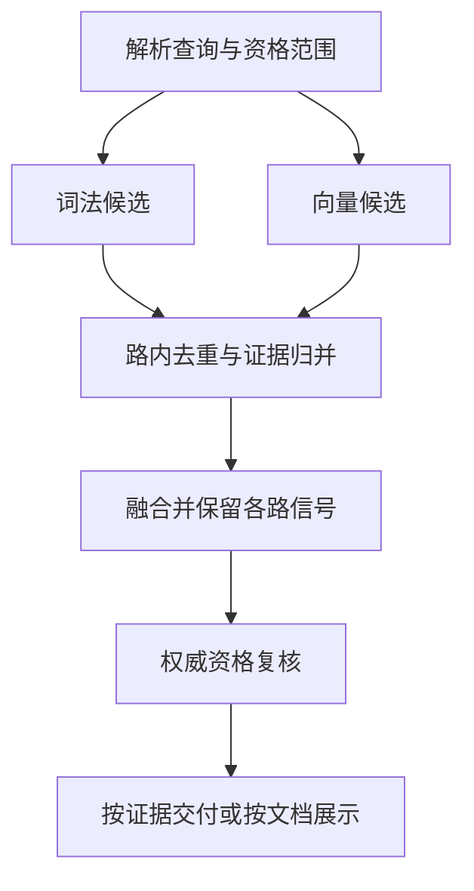

# 08｜BM25 和向量怎么合并？先做可解释的混合基线

**企业级知识库设计与检索质量工程 · 第二阶段**  
阅读约 30–35 分钟 · 可选练习约 10 分钟 · 排名与分数均为合成示例

| 读前要点 | 本篇内容 |
| --- | --- |
| **设计主线** | 统一两路查询的资格范围，从各自候选到证据归并、排名融合和最终交付。 |
| **边界场景** | 两路分数尺度不同、候选深度不对称、同页占满前几名、有两路共同漏召回，以及超时后单路降级。 |
| **方案示例** | 用同一份 Atlas 入场证据手算 RRF，对照分数归一化，写出路由、候选和诊断字段。 |
| **验收** | 同样返回 K 条时，能够解释每条证据如何进入结果，并按精确编号、口语和权限用例判断混合是否有增益。 |

员工问「Atlas 外包入场办门禁，票找谁提？」词法路线先找到申请入口，向量路线先找到入场规定。两份证据都可能有用。第一条说明在哪提交，第二条才写清由谁提交、适用哪一天。如果两条都被召回，却被同一页重复切出的几个片段挤走，混合检索的收益就很难交付给读者。

本期把第 06 期的词法信号与第 07 期的向量信号放在一条请求上，明确每层预算和去重单位。

## 一、同一查询范围，两条召回路径



词法路保留精确编号和可解释的匹配字段，向量路补足自然表达。并行开始以前，两路要约定同一个主体、适用对象、业务日期和读取边界。词法与向量构建进度不同的时候，可按第 05 期状态确认可用代次。合并同一证据时保留各路代次；只对来源、版本与资格一致的候选作归并。

融合前的处理可以拆成以下三步。

1. **按路去重。** 如果词法前十条里有三条指向同一个证据，保留最佳一条，并保留其他命中位置作为诊断信息。
2. **跨路归并。** 以稳定的 `evidence_id` 或明确的等价映射合并同一份原文证据。旧版与现行版有不同的证据身份，避免把历史与当前制度揉成一条。
3. **融合后按需归并文档。** 结果页以证据为主时可保留同一文档的两条独立证据；按文档展示时选最有用的证据作为摘要，并保留关联证据。跨版本历史查询使用明确的分组规则。

如果两条参赛路线都没召回正确证据，后续融合和重排都只能处理已有候选。优先用候选覆盖率判断该加深哪一路、是否要改分片或修索引。

## 二、融合记录要保留哪些字段

| 字段 | 建议记录内容 | 用于什么判断 |
| --- | --- | --- |
| `evidence_id`、`document_version_id`、`source_ref` | 统一证据标识、版本和原文位置 | 归并、回到原文、按证据验收 |
| `route`、`rank`、`raw_score` | 词法或向量路径，路内去重后的排名，原始分数 | 解释哪一路找到证据、为什么升降 |
| `requested_depth`、`returned_depth`、`status` | 各路预算、实际数量及成功、超时或不可用 | 识别候选池缩水与降级 |
| `index_generation`、`fusion_profile` | 路线所用代次和融合方法、参数 | 重放并比较一致版本 |
| `fused_score`、`contributors` | 合成分及每路的分数贡献 | 定位是多路共识、单路头部命中还是配置变化 |
| `drop_reason` 与计数 | 重复、到期、无法确认资格等内部诊断 | 监测过滤与去重损失，面向用户只交付获准结果 |

名次应有统一定义。本篇在每一路先按证据去重，再从 1 开始重新编号。线上如果用引擎内置融合与去重，要记录引擎实际使用的名次。不同排序看似用同一个 RRF 公式，候选和名次不同也会得到不同结论。

## 三、用 RRF 手算一个可追溯的结果

RRF 按各路排名给候选累计贡献。某证据在该路没出现，就不加这一路的贡献。这里取常数 `c=60`。排名第 `r` 的贡献为 `1/(c+r)`。OpenSearch 的 Score ranker processor 提供基于排名的融合配置，参数和适用版本以目标集群文档为准。 [OpenSearch Score ranker processor](https://docs.opensearch.org/latest/search-plugins/search-pipelines/score-ranker-processor/)

合格范围内，词法给出 `E2 → E1 → E4`，向量给出 `E1 → E3 → E2`。

| 证据 | 词法排名 | 向量排名 | RRF 分数 | 最终排名 |
| --- | ---: | ---: | ---: | ---: |
| E1 · 外包首日门禁规定 | 2 | 1 | 0.032522 | 1 |
| E2 · IT 账号申请入口 | 1 | 3 | 0.032266 | 2 |
| E3 · 园区开放时间 FAQ | — | 2 | 0.016129 | 3 |
| E4 · KB-4032 操作说明 | 3 | — | 0.015873 | 4 |

E1 在两路都靠前，合并后超过 E2。把两条排名都算进去，也会让另一些被两路找到的背景资料升高。常数越小，前几名的差距通常越明显。用一个极简对照，单路第一与两路第四相比，`c=1` 时分别为 0.5 与 0.4，`c=60` 时约为 0.0164 与 0.0313。参数会影响是否偏向多路共同命中。

最小逻辑可以用五行表达。此处每路的 `unique_hits` 已按证据去重。

```text
for each available route:
  for rank, evidence in enumerate(route.unique_hits, start=1):
    score[evidence.id] += 1 / (c + rank)
order by score descending, then by stable evidence ID
verify eligibility before delivery
```

对明确输入 `KB-4032` 的请求，可以保留精确标识信号或路由到更适合的排序策略。先确认该候选确实对应此次产品、版本和适用对象，再观察纯 RRF 是否把它压低。这样能区分词法侧候选问题和融合策略问题。

## 四、什么时候考虑分数归一化

BM25 的原始分与不同距离度量转换后的向量分，量纲和分布可能不同。若直接用固定权重相加，分数尺度较宽的一路容易主导。常见做法是先对每路分数变换，再按权重组合；归一化前后的名次和样本范围都应记录。 [OpenSearch Normalization processor](https://docs.opensearch.org/latest/search-plugins/search-pipelines/normalization-processor/)

| 方案 | 主要假设 | 需要验收的情况 |
| --- | --- | --- |
| RRF | 各路名次本身有价值，原始分数可以不比较 | 对候选深度和路内去重敏感，单路精确命中可能被多路背景压低。 |
| 分数归一化后加权 | 本次候选中的分数差距具有解释价值 | 异常高分、短列表、全同分和降级时的取值规则要明确定义。 |
| 意图驱动的组合 | 能稳定识别明确编号、口语查流程等场景 | 错误路由会丢召回，应保留路由原因与后备路径。 |

例如用 Min–Max 时，只有一个候选或每项同分，分母为零。实现需要一条确定规则，比如把该路的平分项赋同一个常数并记录状态。候选边界一变，归一化后的值也可能跟着变。先对比相同候选样本，再决定能否用归一化分数解释线上变化。

## 五、预算、超时和交付不足怎样处理

分别记录词法与向量取多少、融合吃多少，以及用户最多看多少。比如起步设 `lexicalDepth=20`、`vectorDepth=20`、`returnK=5`。这些数值只是实验配置，最终按标注查询、延迟和资源成本调整。

| 线上状态 | 服务行为 | 要记录的证据 |
| --- | --- | --- |
| 两路在预算内完成 | 用同一融合配置处理结果 | 两路贡献、去重前后总量 |
| 向量超时或未就绪 | 在已验证的词法结果上按单路顺序交付 | 降级原因、词法深度和受影响查询段 |
| 词法超时 | 在业务允许的查询上交付可验证的向量结果；对精确编号路由执行预设降级 | 任务类型、可用路线与精确语义是否满足 |
| 权威复核后不足 K 条 | 在剩余预算内补取并复核，或交付已有证据 | 计划深度、实际深度、过滤和补取数量 |
| 两路都不可用 | 返回明确的服务状态或安全空结果 | 每路错误与整体请求预算 |

精确编号查询要提前约定降级语义。如果唯一可用的向量路只有类似编号，可以要求用户重试或提示未找到可核验的处理证据。对于权限与状态不明的内容，复核规则保持一致。

### 预算从片段数换算到可交付的证据数

假设某一路原始排名前四是 E2a、E2b、E2c、E1，其中前三条都是 E2 的重叠切片。如果原始深度设为 3，去重后只有 E2；把返回目标设为三条证据也无法补回已经没取到的 E1。要取得更多独立证据，可以在该路先按证据聚合，或预留额外的原始检索深度。两种做法都要记录原始片段数和去重后的独立证据数。

跨路融合还要保证稳定的并列规则。计算用未四舍五入的分数；展示时可以截断小数，得分相同时用稳定证据 ID 或业务允许的次要排序。这样回放能看出改变来自候选预算、融合算法还是展示层。

## 六、用同一返回预算得到结论

固定原件、资格范围、查询与标签，比较「词法」「向量」「混合」三组的 **证据级 Recall@K**、首个正确证据位置和返回重复情况。另记融合前的联合候选覆盖率，区分没召回和排序排错。把口语、精确编号、规则类查询和权限测试分开汇报。对每组记录端到端延迟、单路时间和降级比率。手算表验证了融合计算与顺序，业务收益仍要由部署后的回归数据确认。

**可选练习。** 把 E2 的词法召回复制两次，并让向量路超时。比较「保留所有片段」「按证据去重」「词法单路交付」三个结果，解释哪一步改变了可读证据数量。下一期会在固定的候选池上看重排能改善多少。
