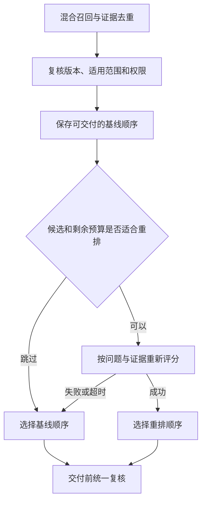

# 09｜重排值不值得上？用延迟预算换排序质量

**企业级知识库设计与检索质量工程 · 第二阶段**  
阅读约 30–35 分钟 · 可选练习约 10 分钟 · 查询、排名与预算均为合成示例

| 读前要点 | 本篇内容 |
| --- | --- |
| **设计主线** | 在同一个候选池内区分字段规则、模型打分与业务约束，用候选覆盖率确定重排的上限。 |
| **边界场景** | 正确证据未召回、输入截断、内容不允许发给模型、模型超时和批量增大带来的尾延迟。 |
| **方案示例** | 对同一批 Atlas 候选比较融合原序、规则重排和模型重排，给出接口字段、截止时间和降级规则。 |
| **验收** | 能说明在哪类查询、什么质量和延迟条件下值得启用重排，以及如何回退到可交付的基线。 |

Atlas 项目负责人问「外包同事第一天办门禁，谁提单？」混合候选第一条是 IT 的账号申请入口，第二条才是「由项目负责人提交门禁申请」。这两条都与入场有关，但只有第二条直接回答了「谁」。另一位同事查「周末应急访客卡找谁」，真正负责周末补办的段落压根没进入候选池。

这两个例子决定了重排的第一条边界：先确认正确证据已召回，再讨论它应该排到哪里。

## 一、重排在链路中接收什么



重排给已取得且合格的候选重新计分。规则可以优先匹配明确编号、适用对象或证据角色。常用的模型方式是 Cross-Encoder，把查询与候选内容成对输入，再输出相关性分数。候选一般先经过轻量检索，再把有限数量送入重排。 [Sentence Transformers Rerankers](https://www.sbert.net/examples/cross_encoder/training/rerankers/README.html)

| 条件 | 执行位置 | 例子 |
| --- | --- | --- |
| 候选资格 | 召回时尽早限定，交付前按权威状态复核 | 失效文件、普通员工不可读的内部手册、外包与正式员工的适用范围。 |
| 可处理范围 | 调用重排服务前 | 已授权阅读的正文仍受独立的数据处理策略约束；传给模型的内容应符合批准的用途和范围。 |
| 排序信号 | 在已合格候选内部使用 | 精确错误码、流程角色、包含责任人和时间条件的证据，以及 query–passage 相关性。 |

资格复核后先保存可信的基线顺序。外部重排服务只接收允许处理的内容，也不能带回未提交的证据 ID。若某些内容只能在内部处理，首版可以触发整次请求的基线排序或内部规则排序，避免把一部分模型分和另一部分融合分直接拼起来。

## 二、给重排传能回答问题的结构

| 字段 | 示例 | 为什么要保留 |
| --- | --- | --- |
| `request_id`、`ranking_profile` | 当前请求 ID、`atlas-rerank-v1` | 对照模型、模板、融合和规则配置。 |
| `query`、`intent_hint` | 「外包首日办门禁，谁提单？」、`assignee_lookup` | 模型和规则使用同一个问题；意图提示只有在已验证时采用。 |
| `evidence_id`、`document_version_id` | `atlas-ingress-v3#badge` | 用稳定 ID 关联得分与来源，处理历史版本和并列候选。 |
| `title`、`section_path`、`evidence_text` | 首日门禁／临时访客区／项目负责人提交 | 提示主题，并保留对象、条件和负责人的原文。 |
| `baseline_rank` | 2 | 支持回退、并列时稳定处理和差异报告。 |
| `candidate_limit`、`deadline` | 例如 20 个候选与本次阶段截止时间 | 避免候选量和输入长度无上限地增长。 |
| `score`、`model_id`、`truncated`、`status` | 相对相关性、模型、是否截断、每项状态 | 判断输出是否完整，解释降级和异常。 |

输入预算要留给能回答问题的条件。对门禁表，列名和「仅限外包工程师入场首日」优先于很长的页眉及文档前言。对跨段落证据，可以在资格允许时补父标题和必要例外。为了定位问题，记录输入长度、是否截断、候选位置和配置版本。敏感查询和正文按业务策略限制留存与访问。

模型输出分数适合同一次配置下的相对排序。若要把分数用于「可回答」门槛，应额外校准并验证不同类型查询的行为。系统要能识别漏项、重复 ID 和分数非法等返回错误，避免把部分响应当成完整排序。

## 三、先比较原序、规则和模型重排

| 起步方案 | 适用问题 | 要验证的风险 |
| --- | --- | --- |
| 融合原序 | 排名已经达到上线指标，或延迟要求很紧 | 多路共同命中的背景证据有时压过能操作的条目。 |
| 字段或业务规则 | 错误码、适用范围、办理角色和证据类别具备稳定结构 | 规则会改变不同查询组，放错优先级可能把标题近似文档推高。 |
| Cross-Encoder 或其他重排模型 | 候选已经覆盖正确条款，但口语、长问题或多条件使原序失准 | 需要检查输入截断、领域偏差、尾延迟、成本和输出完整性。 |

用**完全相同的候选和资格结果**比较三种方案，才能把变化归到重排。如果模型重排同时增加了各路候选深度，就分别记录候选覆盖的增益和排序增益。规则或模型都可以在不需要的查询类型上跳过，例如唯一有效的精确编号证据已排首位。

## 四、用两个查询计算重排的收益上限

在下面的教学实验里，每条查询只有一个标注的正确操作证据，重排候选深度为 4。第一个查询使用与第 08 期类似的材料，但采用不同问法与融合原序。这里的排名是人为构造的对照。

| 查询 | 固定候选池 | 标注证据 | 基线首个正确位次 | 重排后首个正确位次 |
| --- | --- | --- | ---: | ---: |
| Q1 · 外包首日门禁，谁提单？ | E2、E1、E3、E4 | E1 · 外包首日门禁规定 | 2 | 1 |
| Q2 · 周末应急访客卡找谁？ | E3、E1、E4、E2 | E8 · 周末补办规定 | 未召回 | 未召回 |

基线 MRR@4 为 `(1/2 + 0) / 2 = 0.25`，示例重排后为 `(1 + 0) / 2 = 0.5`。两组的正确证据覆盖率都为 1/2。对这批固定候选，即使理想重排也只能把 Q1 放到第 1，Q2 仍无法答出。需要回到索引、字段或候选入口处理 Q2。MRR 对多个必需证据覆盖表达有限；有多条相关证据时可补充证据 Recall@K、必需证据覆盖率，或分级相关标签下的 NDCG。规划评测时固定文档、查询和相关性标注，再比较不同策略。 [NIST TREC Overview](https://trec.nist.gov/overview.html)

## 五、用业务截止时间分配重排预算

区分每次请求的截止时间与线上统计指标。请求截止时间决定这次还能等多久，整体 P95 则要从完成请求的端到端数据统计。记录每段耗时有助于定位尾延迟。服务有 230 毫秒总截止时间时，如果已经花了 118 毫秒，还需给最终复核与响应保留 40 毫秒，重排阶段最多可用 72 毫秒。若重排有 55 毫秒上限，则以 55 毫秒调用。这些是演示数字。

```text
remaining = request_deadline - now - response_reserve
budget = min(rerank_cap, remaining)
if budget < minimum_viable_budget: choose baseline order
if rerank fails, times out, or returns invalid IDs: choose baseline order
both paths recheck current eligibility before delivery
```

实现中要在相同的单调时钟上计算时间。模型调用还要考虑排队、网络延迟及输入长度。超时后取消本次工作或至少尽快释放请求路径，迟到的输出不更新已经交付的结果。若排队持续变长，可先下调候选数或按意图关闭重排，并观察是否回退到可接受的结果质量。

| 发生的情况 | 行为 |
| --- | --- |
| 候选只剩一条或没有合格结果 | 直接走基线，保留原有资格与错误说明。 |
| 关键条件被截断 | 用保留条件的模板重新构建输入；若做不到，按基线交付。 |
| 模型超时或输出不完整 | 使用保存好的、已复核的基线顺序。 |
| 排序结束前资格发生变化 | 按业务要求再复核交付范围；必要时减少返回条数。 |

### 让回放和线上观测能互相对照

三组策略至少各留下 `candidate_count`、`candidate_evidence_ids` 的受控快照、`ranking_profile`、是否走重排及其降级原因。评测集里再补 `candidate_hit` 和 `first_correct_rank`，把「找到了而排错」与「候选未找到」分开。对线上可记录 `rerank_ms`、`total_ms`、`fallback_reason` 和截断率，敏感证据标识只写入具备访问边界的诊断渠道。

先观察重排改变了哪些排序，再在独立的试运行里判断延迟与降级开销。若只有口语查询有明显收益，可以先按已验证的意图启用，并继续观察路由错误造成的漏用。

## 六、用验收条件决定何时启用

先在固定候选池做回放，报告正确证据可能达到的最佳位置、实际指标、截断以及错误类别。再用部署环境的流量分布测量重排耗时、端到端 P95、超时降级率与资源开销。实验区分精确编号、口语流程、多条件或长上下文查询，避免少数样本掩盖关键场景退化。

一套示例启用条件可以这样写。**口语流程组第一条正确证据率提高，精确编号组不退化，线上 P95 和降级率落在本系统规定的上限内。** 权限相关的用例对照召回、模型调用和最终交付，任一环节存在未获准的输出都应先修复。阈值由业务规定与实测确定。本篇验证的是合成排名与预算计算。

**可选练习。** 把 Q1 的正确证据移到候选池外，重新计算 MRR 上限。再把前序耗时改为 185 毫秒，算重排还剩多少预算。说明这两种情况下各要改哪个环节。下一阶段会深入权限和治理，专门处理 ACL 继承、撤权、删除与制度冲突。
