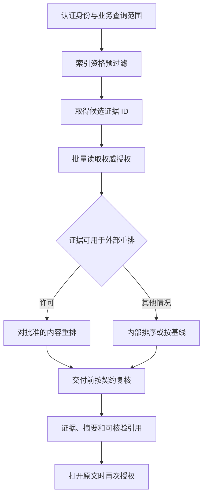

# 10｜同一个问题，为什么两个人该看到不同结果？

**企业级知识库设计与检索质量工程 · 第三阶段**  
阅读约 30–35 分钟 · 可选练习约 10 分钟 · Atlas 身份、文档与权限记录均为合成示例

| 读前要点 | 本篇内容 |
| --- | --- |
| **设计主线** | 分开建模提问者、组成员关系、资源访问控制列表（ACL）和业务适用对象。召回时收窄范围，交付前再检查权威权限。 |
| **边界场景** | 跨项目、目录继承与显式例外、撤权时索引或缓存落后、权限源不可用、标题与摘要泄露，以及历史搜索。 |
| **方案示例** | 设计一套成员关系与资源 ACL 字段、一条批量授权接口，并用一次撤权推演搜索、重排、缓存与下载的行为。 |
| **验收** | 普通员工和 Atlas 成员共同看到获准的入场依据。受限手册只有当前仍有授权的成员才能读到，并且外部重排另行检查处理权限。 |

两名员工都问「外包同事第一天进 Atlas 项目，谁提交门禁申请？」两人都应该看到行政规定中的「项目负责人提交」。Atlas 成员还能打开项目内部的联调手册，知道门禁办完后怎样到值守区报到。普通员工的搜索里则只会出现适用且可读的依据。

第二阶段已经解决了「哪个候选更有用」。这次先把四个问题拆开：谁在问、为谁问、哪天的规则适用，以及此人此刻能否读取资源。

## 一、提问者和制度对象是两回事

用首期的 `QueryContext` 增加权限上下文。产品可以让用户显式选择业务对象；身份和组织边界来自认证后的服务端状态。

| 字段或关系 | 样例 | 在链路中的职责 |
| --- | --- | --- |
| `tenant_id` | `acme` | 在连接器、索引、缓存和权限评估中限定组织边界。由服务端根据会话确认。 |
| `principal_id` | `employee-17` 或 `member-23` | 当前请求的提问者。权限检查围绕此主体展开。 |
| 成员关系 | `member-23` 属于 `group:atlas` | 表达公司、部门或项目组授权。成员从组退出后，仍应评估其他可能存在的有效授权。 |
| `subject`、`business_as_of` | `contractor`、`2026-11-20` | 指明为谁、查哪天适用的规定，沿用第一阶段的有效期判定。 |
| `resource_key`、`action` | `atlas-runbook-v4#badge`、`read_evidence` | 权威服务使用的资源与操作。下载原件、浏览元数据和对外部服务处理文本可有不同策略。 |
| `authz_revision` | `policy-42` | 记录授权判定使用的策略水位，用于撤权验收、缓存隔离与诊断。 |

「为 Atlas 查」「我是项目负责人」可以成为问题描述。认证身份、组和资源的授权关系须由权威来源确认。历史搜索用 `business_as_of` 回到当时适用的条款，继续以**现在的访问权限**决定能否读取旧原件。

## 二、怎样把源系统的 ACL 映射过来

Atlas 手册来自项目空间。空间允许 `group:atlas` 阅读，一份复盘附件可能另有名单。接入时先确认上游的授权语义，再按一种足够简单的模型落地。

| 对象或字段 | 最小设计 | 处理原则 |
| --- | --- | --- |
| `subject_ref` | 组织内用户、组及外部身份的映射 | 用稳定 ID 映射，名称只供展示。映射不明时进入同步异常。 |
| `parent_resource_key`、`inherit_acl` | 文件夹、文档、证据块的关系及是否继承 | 同步明确的父子关系和例外，检查移动目录、主动切断继承与嵌套组。 |
| `permission`、`effect` | 本系统支持的操作与允许或拒绝语义 | 按上游约束翻译。若规则无法等价表达，暂停交付并由资源负责方确认。 |
| `source_policy_revision`、`last_verified_at` | 来源版本与校验时间 | 区分可信的当前状态、等同步的旧投影和不可确认的状态。 |
| `processing_policy_id` | 允许内部模型、本地处理或指定外部服务 | 请求人有阅读权时，仍按处理目的检查内容能否交给下游。 |

规模小、权限规则简单时，可以把组成员关系、资源授权和继承存在关系数据库里。查询时索引保存可过滤的组织、项目或组标签，资源阅读仍由权威服务判定。需要多级继承、共享、例外转授或多系统复用时，可以评估关系型授权服务，把「谁以何种关系连接到资源」显式建模。先验证业务图是否表达正确，再选择存储和查询方案。 [OpenFGA 的父子资源模型](https://openfga.dev/docs/modeling/parent-child)

文档级 ACL 是实用的起点。如果同页有不同公开范围的内容，要按可授权单位划分证据。返回某一段的能力也不能自动授予阅读整份 PDF 的能力。来源页可以只渲染已授权的证据区段；需要整份原件时单独检查 `read_original`。

## 三、从检索开始，到返回或下载，在哪里检查



**预过滤负责容量，权威检查负责访问。** 预过滤让合格证据不被其他团队的结果挤出 Top K。当搜索索引的权限投影落后，允许状态可能存在两种偏差：撤权后仍召回，或授权后暂时召回不到。前者必须在权威检查阻断，后者应依靠同步追赶、按预算补取或内部回放修复。

批量接口接收可信身份与资源标识，服务返回每项结果和用于判定的策略水位。授权输入不能采用客户传来的组名列表冒充当前权威成员关系。项目手册的正文、标题摘要和指向原文的链接，都在许可判定后才用于相应目的。对象级授权应落实到每次资源请求，并为无法识别的权限关系设置拒绝或待确认路径。 [OWASP Authorization Cheat Sheet](https://cheatsheetseries.owasp.org/cheatsheets/Authorization_Cheat_Sheet.html)

```text
batchCheck(可信组织与提问者, 资源列表, read_evidence, 所需策略水位)
→ 每项 allowed / denied / unknown，附判定水位
allowed 项进入后续处理；外部重排另查处理许可
返回、原文访问与下载按当前权威状态和各自操作复核
```

批量授权可以用「部分可交付」处理超时。只交付有当前可验证许可的证据。对缺失、拒绝或无法确认的受限资源，统一使用产品约定的无结果或证据不足表示。标题、自动补全、分面计数、日志和回放样本也要经过权限边界，避免它们成为另外的暴露渠道。

## 四、一次撤权要追到哪些读路径

撤权场景采用这个教学契约：**权威变更确认后新开始的请求，应使用不早于该变更的权限状态。** 使用一致读的服务要保证自己读取到此水位。采用版本令牌时，必须让后续请求能拿到所需的最小版本；只有令牌字段或短 TTL 无法证明新请求看到了变更。对在途请求，产品应另定判定点和处置方式。授权一致性与缓存的取舍，可对照公开的授权系统论文与产品文档。 [Zanzibar 论文](https://research.google/pubs/zanzibar-googles-consistent-global-authorization-system/) · [OpenFGA 查询一致性模式](https://openfga.dev/docs/interacting/consistency)

| 位置 | 权限投影仍停在 41，权威已变成 42 时预期怎样 |
| --- | --- |
| 词法、向量索引 | 可以产生供可信链路处理的旧候选 ID；权威检查剔除已撤权资源。 |
| 搜索缓存 | 将结果视作候选引用，命中后复核当前资源权限。版本键或失效通知用于减少旧命中。 |
| 外部重排 | 正文在发出前经过读取权与处理许可两道检查；不可处理的资源走内部方案。 |
| 来源页和下载 | 请求者每次访问都按该操作检查。若业务要求撤权后关闭下载，可采用受控下载服务，并明确已经签发的临时链接在其有效期内如何失效。 |
| 可观测性 | 内部记录撤权水位、被拦截候选数和耗时；面向用户的结果不描述受限资源详情。 |

把权限丢失后的缓存、索引和来源链路一起回放。只有查看搜索结果页往往不够，实际暴露也可能发生在自动补全、引用预览、点击下载或模型请求中。

## 五、把同问异果变成可执行的验收

以 Atlas 外包首日为同一个 `subject` 与业务日期。E1 是企业内部可读的行政规定，E5 是项目成员可读的手册。两条内容的业务适用性独立配置。

| 回放条件 | 应得到什么 |
| --- | --- |
| 普通员工和 Atlas 成员查外包首日 | 两人都可返回 E1；只有仍获授权的成员能看 E5。 |
| 成员退出项目后，使用旧索引和旧候选缓存 | 首次新请求不得交付 E5；E1 仍可按其权限与适用性返回。 |
| 原团队组撤权，另有合法直授读取 | 权威评估仍按真实有效关系决定 E5 是否可交付。 |
| 用旧日期查 E5 | 业务日期可带回历史条款，但仍检查当前身份权限。 |
| 权限源只能确认 E1，E5 状态不明 | 只交付被确认的 E1。 |
| 成员有读取权，但 E5 不允许发送到外部模型 | E5 可用于允许的内部处理，不交给外部重排。 |
| 用已撤权身份打开已知来源地址 | 块级与整份原件分别检查，响应遵循产品规定的安全约定。 |

**可选练习。** 为 Atlas 手册建立「文件夹继承组权限」和「文件显式单独授权」两组输入。模拟成员退出项目、业务日期回到过去、以及权限服务超时，分别写出候选、外部重排和最终交付会看见什么。

下一期会处理另一种滞后。源系统已经删除了文件，为什么搜索还会保留候选？答案取决于事件顺序、权威目录和派生索引分别到了哪一步。
