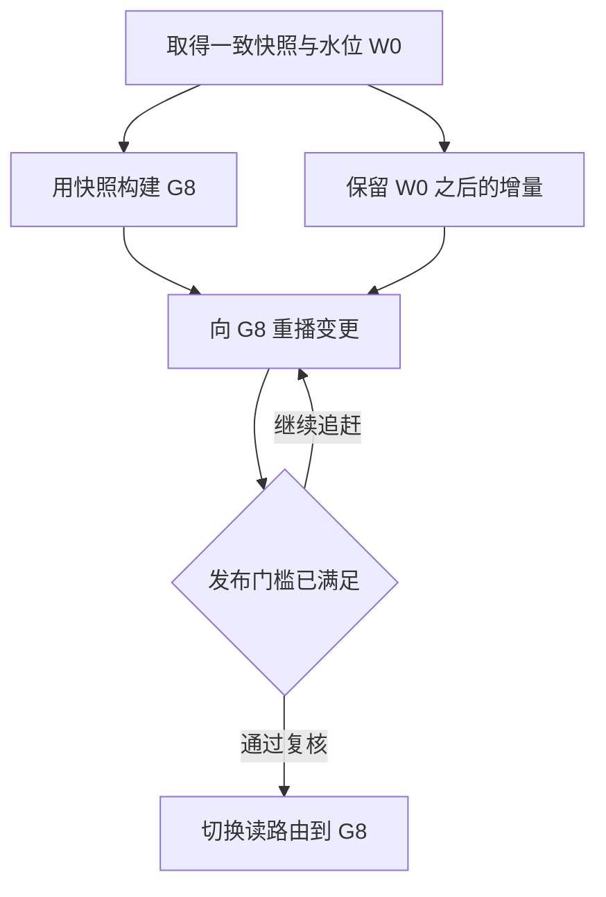

# 11｜文档删了，搜索为什么还找得到？

**企业级知识库设计与检索质量工程 · 第三阶段**  
阅读约 30–35 分钟 · 可选练习约 10 分钟 · 事件序号、版本与索引代次均为合成示例

| 读前要点 | 本篇内容 |
| --- | --- |
| **设计主线** | 区分业务生效、上游变更、平台接收和索引可见的时间。先落权威状态，再推进可重试的索引投影。 |
| **边界场景** | 重复投递与乱序、旧文档复活、源记录改路径、重建期间持续更新，以及内容与权限各自的同步速度。 |
| **方案示例** | 设计变更事件和删除标记，用乱序事件回放版本选择，再推演全量重建、增量追赶和切换。 |
| **验收** | 能解释哪一条旧事件应忽略、当前查询靠什么拒绝已删除内容，以及新代索引在什么条件下可切换。 |

Atlas 项目经理在源系统删除了一份旧的联调手册。几个小时后，搜索有时还能看到该手册。排查发现删除事件已经到达平台，但索引删除未成功。另一个 worker 又晚到了，它拿着早先缓存的手册内容，准备重新写入。只在搜索引擎里执行一次删除，无法覆盖这个过程。

本期把**权威目录、变更记录、索引投影和查询门槛**拆开。删除、撤回发布、版本失效，以及那个版本仍能否被合格人员作为历史证据使用，都需要有独立语义。

## 一、四个时间回答不同的问题

| 字段 | 记录位置 | 能解释什么 |
| --- | --- | --- |
| `effective_from`、`effective_until` | 制度版本 | 在业务日期的哪一段适用，沿用第 01 期半开区间。 |
| `source_changed_at` | 上游变更记录 | 上游何时观察到移动、更新或删除。用于诊断，经时钟差异修正后才适合比较耗时。 |
| `accepted_at` | 本地权威目录或事件日志 | 平台何时确认变更。例如从此时起，新请求应按已确认的删除状态过滤。 |
| `searchable_at` | 各索引代次的读路径验证结果 | 派生结构何时真正反映了变更。删除时可以记录 `removed_from_index_at`。 |

平台刚观察到删除时，应先提交权威目录的状态变化。从这一点起，索引候选、缓存、原文页都要使用新状态。另一个问题是平台在上游删除多久后才观察到。这取决于连接器和来源。可同时记录「上游至确认」与「确认至索引收敛」两段延迟，区分扫描频率问题和索引处理问题。

## 二、同一个对象怎样积累变更

| 字段 | 示例 | 设计用途 |
| --- | --- | --- |
| `source_record_key` | `acme/wiki/atlas/901` | 由组织、来源实例与稳定源 ID 组成。移动或改名更新路径，仍能找到原记录。 |
| `event_id`、`operation` | `ev-33`、`delete` | 区分重放事件及其动作。相同事件 ID 应对应相同消息。 |
| `source_revision` | `33` | 仅在来源保证同一对象可比较时用于阻挡旧写入。 |
| `stream_position` | `partition-2:1847` | 表示增量消费者或重建的进度。它可与对象版本不同。 |
| `expected_payload_hash` | 工件或规范化快照的指纹 | 同一版本收到不同负载时记录冲突，避免静默覆盖。 |
| `lifecycle`、`deleted_revision` | `deleted`、`33` | 保存可执行的删除标记，防止存量重放重新激活旧内容。 |
| `acl_revision` | `policy-42` | 权限更新独立确认。处理正文成功不会推进权限水位。 |

有的来源只提供不透明的 ETag 或增量令牌。它们可用于比较相等和恢复分页，不能直接当作自增版本。遇到无法排序的事件，可以把通知当成「重新读取该对象」的信号，再把权威快照写入本地。增量页先持久化变更和后续任务，再提交进度。上游若要求重新开始一轮同步，先完成新一轮清单对账，再处理确认缺失的对象。 [Microsoft Graph 增量查询](https://learn.microsoft.com/en-us/graph/delta-query-overview)

本篇的数字版本示例假设每条非删除内容事件携带完整且已验证的对象快照。若来源只发送局部补丁，应用版本门槛之前还要处理补丁顺序、缺口和基线。比如较晚的「改名」补丁不包含较早的正文修改，直接跳到最大版本会丢内容。

## 三、用一个删除标记推演乱序

从当前活跃的版本 30 开始，按下列**接收顺序**执行。删除记录随事务提交，索引异步追赶。

| 接收次序 | 事件 | 权威目录状态 | 搜索应如何处理 |
| ---: | --- | --- | --- |
| 1 | v31 · 手册移动，源 ID 一致 | v31 活跃，更新路径 | 旧路径跳转或源引用更新；按当前版本交付。 |
| 2 | v33 · 来源删除 | v33 已删除，保留删除标记 | 即使索引还返回 v31，也在交付前剔除。 |
| 3 | 同一条 v33 删除重复投递 | 状态保持 v33 已删除 | 幂等确认，索引删除任务也可安全重试。 |
| 4 | v32 · 晚到的内容更新 | v32 早于删除版本，忽略 | 旧 worker 无法借旧内容重开交付。 |
| 5 | v34 · 未经复核的普通写入 | 拒绝隐式恢复，记录待确认 | 当前维持不可见。 |
| 6 | v35 · 已验证的明确恢复 | 进入新版本的审核及构建；就绪后才可见 | 审查权限、内容和索引，再按第 05 期发布。 |

这张表选用「删除后需要独立恢复确认」的业务规则。若来源允许重新使用同一个外部 ID，要用来源提供的对象实例信息，或在本地登记新的文档身份，防止旧删除标记误伤新文件。

```text
已确认的事件 ID 和负载一致 → 幂等返回；同 ID 负载不同 → 记录冲突
到达版本更旧 → 跳过；同版本负载不同 → 记录冲突
当前为删除状态且缺少已批准恢复 → 保持删除
其余事件 → 事务更新权威目录与待投影记录
```

权威状态和待投影记录应一起提交。分发可以采用第 05 期的事务 Outbox，索引消费仍按幂等方式处理重放。写索引前做版本检查，以及真正提交写入之间仍可能发生并发。可在索引写入侧应用有明确语义的版本条件，或给证据条目加上不可变的内容版本和代次，并在查询交付时核对目录中允许的版本。只检查一次再无条件覆盖同一个索引 ID，会留下旧任务覆盖新任务的窗口。 [AWS 事务 Outbox 设计模式](https://docs.aws.amazon.com/prescriptive-guidance/latest/cloud-design-patterns/transactional-outbox.html)

## 四、全量重建如何接住同时发生的变化

假设当前索引为 G7，升级切片后构建 G8。G7 继续服务，并用当前权限和目录状态过滤。重建需要取得**相互对应的权威快照与变更水位**。



1. 用一致快照和变化流边界固定 W0，确保静态副本与后续重放之间没有缺口。按分区记录水位；遇到不保证提交顺序的源，使用平台能提供的一致读机制并做清单对账。
2. G8 先按快照建索引，再处理 W0 后的新增、更新和删除。进度确认要覆盖连续的已处理区间，不能以「收到的最大位置」代表中间全成功。
3. 核对目标水位、可见证据清单、积压、删除和权限用例。到切换时仍会有更新，需通过短暂协调、双投影或持续追赶交接增量消费者，保护切换窗口里的变更。
4. 切换读路由与配置。使用索引别名等机制前，确认指定引擎版本的切换语义；旧代即使保留用来回退，也继续执行当前权威删除状态与访问控制。 [OpenSearch 索引别名](https://docs.opensearch.org/latest/im-plugin/index-alias/)

如果 G8 在追赶期间重新看到了删除前的手册，回放应把已验证的删除或更新应用到 G8。验收必须直接用新代次查询并检查原件入口。仅查看构建任务结束或总文档数一致，很难区分「少删了一条」与「少建了一条」。

## 五、把下线、归档和物理清理分开验收

| 业务动作 | 权威目录与查询 | 原件和处理产物 |
| --- | --- | --- |
| 正常的制度换版 | 旧版对当前日期失效；历史用途可按权限与有效区间查旧版 | 按留存策略保留并可定位。 |
| 撤回发布 | 当前停止交付；受控归档能否读取由授权和状态决定 | 根据审核用途保存或隔离。 |
| 来源删除 | 权威状态阻止普通查询、缓存和来源交付；异步清理索引 | 按来源要求与组织政策处理原件和各派生产物。 |
| 到期清理 | 保留不得再交付的状态，验证旧快照或重建不会重新开启 | 依据留存和删除策略清理允许范围内的存储、备份及副本。 |

保留删除标记是为了阻止重放。它应只记录阻断恢复所需的最小信息，并与事件可重放的时间范围、备份恢复流程和来源身份策略一起设计。运维对账检查应覆盖词法、向量、缓存、来源页和文件下载。第 10 期的权限水位依然独立检查。

**可选练习。** 在表中插入一条「G8 已构建静态快照，v33 此时才提交」。分别指出 G7 的索引可能包含什么、G8 需要重放什么，以及两个代次在删除确认后实际应交付什么。再想一条失败用例，让 v32 重新进入但是始终无法成为可交付版本。

下一期会处理两个都仍然有效的来源。碰到 Wiki 和制度写法不一致，怎样判断应该交付哪条依据，又怎样让缓存跟得上变化？
