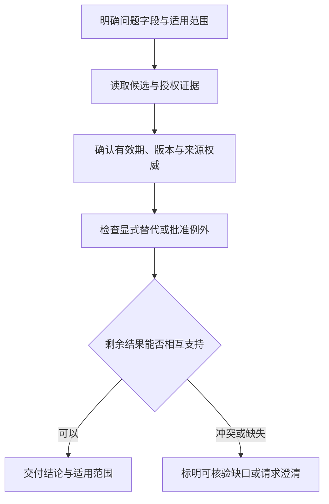

# 12｜Wiki 和制度写得不一样，该相信谁？

**企业级知识库设计与检索质量工程 · 第三阶段**  
阅读约 30–35 分钟 · 可选练习约 10 分钟 · 制度、决策记录和失效场景均为合成示例

| 读前要点 | 本篇内容 |
| --- | --- |
| **设计主线** | 先确定要判断的业务字段，再按适用范围、有效时间、来源权威和显式例外选择证据。 |
| **边界场景** | 正式文件有效期重叠、Wiki 摘要落后、项目补充与冲突、追溯生效，以及缓存被跨身份复用。 |
| **方案示例** | 设计规则、权威和冲突字段，手推 Atlas 门禁责任人，在命中缓存后复核权限、版本和规则依赖。 |
| **验收** | 能在可核验的证据中解释参照哪份规定；未消解冲突时交付合适的状态；权限或制度变更后不会继续交付旧结论。 |

Atlas 外包同事问「入场首日的临时门禁由谁提交？」行政正式入场规定写着「项目负责人」，IT Wiki 的摘要却写「外包本人」。项目手册还要求联调区申请通过安全组复核。词法可能把 Wiki 排第一，向量也可能把项目手册排得很高，但眼前的问题是：**谁有权规定提交人、补充步骤是否改变这条规则，以及当前日期适用哪一版。**

第 10 期负责访问，第 11 期让更新和删除进入权威目录。本期把这些证据放到一个具体问题下，得到「有明确依据」「有适用例外」或「需要确认」的决定。

## 一、把问题拆到需要判定的字段

「门禁怎么办」可以分成提交人、审核人、申请入口、适用区域和时间。两份材料可能各自只回答其中一项，也可能对同一项给出不一致的结论。

| 字段或关系 | 样例 | 决策中怎样使用 |
| --- | --- | --- |
| `topic_key`、`field_key` | `site_access`、`submitter` | 把制度比较限定到同一个业务字段。提交人和审核人通常分别判断。 |
| `policy_id`、`source_ref` | `admin-ingress-v3`、原件第 4 页的表格行 | 追踪给定结论来自哪份版本和原文，可直接核验。 |
| `authority_scope` | 行政决定入场办理规则；IT 维护工单入口 | 授权来源能在哪些字段、范围和时间内作决定。 |
| `applies_to` | 外包、Atlas、首日、临时访客区 | 说明业务对象、区域和场景。适用范围不明确时可先澄清。 |
| `effective_from`、`effective_until` | `2026-10-01` 起生效 | 判断给定业务日下的有效规则。 |
| `supersedes`、`override_of` | 废止旧版，或经授权覆盖某条规则在特定场景的值 | 明确替代与例外关系。范围更窄的项目规则需要有可核验的授权。 |
| `recorded_from`、`recorded_until` | 平台开始和停止采用这一解释的时间 | 支持「当时系统知道什么」的回溯。由事实更正和记录时间驱动。 |

可从制度负责人维护的小型权威表起步。一行说明「谁能决定哪个字段、适用什么范围，例外是否需要审批」。对于跨部门的规则，不宜给所有文档设一个全局高低分。行政可能决定谁提交，服务台可能只负责给出入口。字段级权威使两条证据可以共同回答一个问题。

## 二、用有顺序的规则比较候选



实际可以分三步做判断。

1. **统一比较范围。** 固定提问者、业务对象、字段、业务日期及必要的区域或项目。复核授权和有效时间，让无法读取的证据停在边界内。
2. **核查权威与关系。** 按字段查负责方，用已审核的替代或例外边连接旧规则与新规则。项目说明可以补充审核步骤；若要改变提交人，需要有决定该字段的授权。
3. **合并或报告。** 同值可择优引用并保留辅助来源；不同字段可以同时呈现。同一字段有两个适用的同等权威值且缺少明确优先规则时，标出冲突或交给维护人处理。

对外只能解释当前提问者可读取的证据。若权威目录表明本次场景必须核对一条例外，而提问者没有可交付的凭据，就返回通用的证据不足状态。通用制度或 Wiki 摘要可作为已标明范围的背景，当前场景仍保持待确认。受限原件的标题、所在项目或冲突细节都应按第 10 期策略处理。

## 三、复盘 Atlas 的三份材料

本例业务日期为 11 月 20 日，问题只询问普通临时访客区、外包首日的门禁。

| 来源 | 原文的业务字段 | 权威与适用范围 | 在本次查询中的作用 |
| --- | --- | --- | --- |
| A1 · 现行行政制度 | 提交人＝项目负责人 | 已发布，适用于外包首日临时门禁，行政负责该字段 | 作为提交人主依据 |
| W1 · IT Wiki 旧摘要 | 提交人＝外包本人；包含工单入口 | IT 负责入口；摘要的提交规则来自旧版 | 提交人的说法标为过期待修；入口经独立核验后可用 |
| P1 · Atlas 联调区手册 | 联调区审核人＝安全组 | 项目范围的补充步骤，项目成员可读 | 普通临时访客区不引用；查询联调区时向获准成员补充审核人 |

对本次问题，结论是「由项目负责人提交」，引用 A1 的第 4 页表格。用户若追加「工单在哪」，可以引入现行、已核验的 IT 入口。若用户询问联调区，仍要区分提交人与审核人，并按权限判断 P1 能否作为补充证据。

再加两个便于验收的变体。**批准的例外**是行政明确授权某办公点在夜间由值班主管提交，且例外写明覆盖 A1 的提交人字段。查询条件匹配时可以引用此例外。**同级制度冲突**是另一个仍有效的正式行政版本给出「行政运营提交」，范围与 A1 相同，未声明替代或优先级。此时交付冲突状态和可核验的两份来源，避免把任一值当成确定结论。

```text
过滤不可交付、日期无效或范围不符的证据
按业务字段核对权威来源与批准的替代、例外
一致值 → 输出并引用；未解决的不同值 → 记录冲突
没有充分而可交付的依据 → 返回证据不足
```

这段流程用于决定证据作用。后续第 13 期会进一步设计如何把答案中的每一条主张绑定到证据，并对部分资料也能回答的情况保留边界。

## 四、补录与追溯生效怎样表达

假设 11 月 18 日确认了一份更正说明，规定从 11 月 1 日起，某办公点的门禁申请由值班主管提交。两个问题都提到 11 月 5 日，但需要不同的信息。

| 问法 | 业务日期 | 采用哪一刻所知的记录 | 这个例子的推导 |
| --- | --- | --- | --- |
| 现在回看，11 月 5 日按哪条规则执行？ | 11 月 5 日 | 采用当前已确认的记录 | 看到从 11 月 1 日生效的更正，回答值班主管。 |
| 11 月 5 日当时，系统根据什么给出答案？ | 11 月 5 日 | 只采用当时已登记的记录 | 如果当时只有 A1，复现系统当时会给出的项目负责人。 |

第一条只需要查询适用的业务时间和当前资料。第二条需要保留版本事实被系统采用的时间区间。可按第 01 期约定用 `business_as_of` 和 `known_at` 表达两个轴。旧查询记录可作为审计材料，但对外读取旧证据仍检查当前权限。若还要精确复现当时的排序，额外记录索引代次和排序配置。 [Bitemporal History](https://martinfowler.com/articles/bitemporal-history.html)

## 五、把缓存当成可以验证的加速层

来源规则、索引和权限可以分别变化。缓存命中只表示某次计算已经完成。用它向用户交付时，还需验证其依赖仍然成立。

| 缓存层 | 可保存的内容 | 命中后与失效时做什么 |
| --- | --- | --- |
| 原件或解析产物 | 不可变的版本内容与解析产物引用 | 每次读取做资源授权。更新索引可以复用相同原件与解析配置。 |
| 检索候选 | 已归并的证据 ID、路由与代次 | 重新检查当前 ACL、目录状态和业务时间；必要时重新召回补足候选。 |
| 规则决定或答案 | 结论与完整依赖清单 | 验证证据版本与有效区间、权威和例外规则、可交付范围及版本水位；条件不成立则重算。 |
| HTTP 响应 | 可访问范围对应的响应 | 个性化响应设置与服务策略相符的缓存控制。例如私有响应应避开共享缓存；更严格场景可禁止存储。 |

HTTP 的 `private` 与 `no-store` 有不同语义。应用内的授权复核和规则版本管理仍需单独设计。 [RFC 9111 · HTTP Caching](https://www.rfc-editor.org/rfc/rfc9111.html)

在 Atlas 起步，优先缓存证据 ID 与必要诊断。一个**概念缓存键**包含这些字段。

| 键的组成 | 为何需要 |
| --- | --- |
| `tenant_id`、`principal_scope_key` | 区分组织和确实等价的可交付范围。起步可按提问者隔离。 |
| `query_fingerprint`、`resolution_profile` | 区分问题、字段判定和规则配置；缓存日志避免写入原始敏感问句。 |
| `subject`、业务范围、`business_as_of`、可选 `known_at` | 区分普通区与联调区、人员类型、当天与历史视图。 |
| `catalog_revision`、`authority_rules_revision`、`index_generation` | 交付状态、权威表和召回候选来自哪个版本。 |
| `authz_revision` 或其他可验证的授权水位 | 帮助识别旧结果；交付前仍执行当前授权检查。 |

键中的水位必须有可靠的更新和获取方式。只把水位写入字段，或把 TTL 缩短，无法证明权限或权威规则仍然有效。发布新制度、撤回正文、例外生效和权限变更分别触发失效与复核。在版本切换窗口里，可以用较短的缓存期限降低重复计算和失效延迟，同时每次仍核对业务日期和依赖状态。

## 六、把证据决定写成验收用例

| 变化 | 预期结果 |
| --- | --- |
| Wiki 摘要与现行行政制度写法不同 | 提交人以 A1 为依据，IT 入口单独核验。 |
| 两份同级正式制度覆盖相同字段和时段 | 交付冲突状态，列出当前提问者可核验的冲突依据。 |
| 有效且获批的夜间例外 | 只有查询条件满足时，提交人按该例外选取。 |
| 例外要求区域，但用户未提供区域 | 提示补充范围，或给出带条件的分支。 |
| 回看业务日期与复现当时记录 | 通过 `business_as_of` 和 `known_at` 解释不同结论。 |
| Atlas 成员的结果命中普通员工请求 | 身份范围隔离；普通员工只能收到当前获准的内容。 |
| 同一个人权限未变，但负责人制度改版 | 复核目录与权威依赖后重算决定，引用现行版本。 |
| 缓存中的原件已被删或撤回 | 权威状态阻止旧引用和结论继续交付。 |

**可选练习。** 给 A1 加一条「仅夜间由值班主管提交」的明确授权例外，分别评估白天、夜间、缺失时段三个查询。再让其中一个查询先命中旧缓存，指出需要复核的字段与证据。第三阶段完成了权限、生命周期和政策选择。第 13 期会在此基础上把生成答案的主张逐条绑定到原文。
