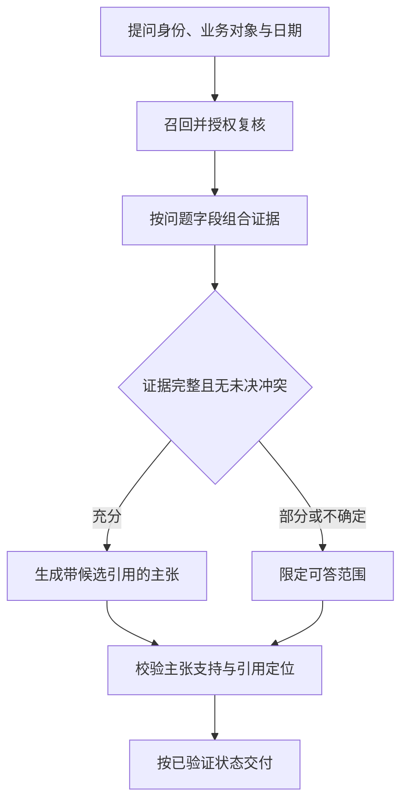

# 13｜答案带了链接，怎么证明链接真的支持答案？

**企业级知识库设计与检索质量工程 · 第四阶段**  
阅读约 30–35 分钟 · 可选练习约 10 分钟 · 文档、问答和验收样本均为合成示例

| 读前要点 | 本篇内容 |
| --- | --- |
| **设计主线** | 把检索到证据、组合证据、写出主张和复核引用分开，定义充分、部分充分、缺失与冲突的响应。 |
| **边界场景** | 链接可打开但正文不支持结论，跨页条件丢失，证据冲突，文档里含不可信指令，以及模型只拿到部分合格证据。 |
| **方案示例** | 用 Atlas 门禁问题定义 `claim_id`、原文定位和证据状态，给出逐项核对与部分回答的结构。 |
| **验收** | 每个关键主张都能回到同一版本的原文，并验证动作、对象、业务日期和例外；缺少必要依据时保留明确缺口。 |

外包同事问「第一天进 Atlas，谁替我提交门禁申请？单子在哪？」系统回答「项目负责人提交，走 IT 工单」，末尾放了一个行政规定链接。点进去，行政规定确实写了提交人。它没有指定 IT 工单，也可能只适用于临时访客区。

一条链接可以支持部分答案。要知道它支持到哪一步，先把问题拆成能核对的业务主张，再分别绑定证据。第 12 期解决「哪份条款有资格决定一个字段」，本期把这个决定落实到答案中。

## 一、先写出两项需要回答的主张

固定问题对象为 Atlas 项目的外包同事、业务日期为 11 月 20 日、场景为普通临时访客区。把「谁提交」「在哪里提交」分到两个回答槽位。

| 主张 | 候选依据 | 证据需要覆盖什么 |
| --- | --- | --- |
| C1 · 项目负责人提交首日临时门禁申请 | A1 · 行政入场制度第 4 页门禁表 | 提交动作、负责角色、外包身份、首日、区域和有效期。 |
| C2 · 进入指定的门禁办理入口提交 | I1 · 已核验的 IT 服务目录对应条目 | 同一个办理事项以及可用的入口。旧页面或其他业务的工单入口无法完成这项核对。 |
| 可选补充 · 联调区需要安全组复核 | P1 · Atlas 项目受限手册 | 区域改为联调区，且提问者实际获准读取和使用该证据；审核人与提交人分别陈述。 |

同一个来源可以支持多个主张，一个主张也可能需要多个原文片段共同支持。例如 A1 第 3 页的表头「适用对象」延续到第 4 页，后者只有数据行。两处都要纳入原文定位，给引用检查保留字段和值的关系。

## 二、让证据结构服务于引用

| 字段或对象 | 示例 | 为什么需要 |
| --- | --- | --- |
| `claim_id`、`claim_text` | `C1`、项目负责人提交外包首日临时门禁 | 一个 ID 对应可独立验证的主张。 |
| `requested_slot`、`required` | `submitter`，必答 | 和问题中的每个子问题对齐，方便区分部分回答和完全回答。 |
| `evidence_id`、`document_version_id` | `atlas-ingress-v3#badge`、`atlas-ingress-v3` | 与第 04 期的原文证据以及具体版本对齐。 |
| `source_spans` | 第 3 页表头、第 4 页数据行 | 源页、锚点、表格范围或文本跨度可供定位与复核。 |
| `scope`、`business_as_of` | 外包首日、普通临时访客区、11 月 20 日 | 验证原文条件和本次语境是否一致。 |
| `support_status`、`reason_code` | `supported`、`missing_source`、`unresolved_conflict` | 区分支持、不足与冲突。内部记录诊断原因，对用户使用可安全披露的说明。 |
| `citation_refs` | 已提交、已核对的证据 ID 列表 | 生成可点击引用。来源访问仍按当前请求重新授权。 |

模型提交的引用通常只允许从这次请求为它签发的证据 ID 中选取。展示层从受控注册表解析 URL、页码和锚点。引用存在只证明能指向资料；**主张支持检查**还要比较原文与所声称的事实。不能把模型自行填出的链接、版本号或原文页码当成验证结果。关于如何同时评估回答与引用，可参照 ALCE 的评测设计。 [Enabling Large Language Models to Generate Text with Citations](https://arxiv.org/abs/2305.14627)

## 三、证据从召回到答案应经过哪些检查



- **组合前。** 按业务字段核查权威、适用范围和规则冲突，检索分数帮助找候选。把必需原文和限制条件一起放进生成上下文。
- **生成时。** 给模型一份有限证据包和所需回答槽位。检索文本属于业务数据，其中的指令性语言无需获得执行权限；生成服务采用最小能力边界，工具调用与外发权限仍由可信流程决定。后端也要核查数据可处理范围。 [OWASP LLM Prompt Injection Prevention Cheat Sheet](https://cheatsheetseries.owasp.org/cheatsheets/LLM_Prompt_Injection_Prevention_Cheat_Sheet.html)
- **交付前。** 验证引用 ID、版本和授权，再按主张校验语义与条件。结构化字段可以做确定性核对，文本主张可加语义验证和人工抽审。重要事实的状态仍由证据与业务规则决定；验证器无法确认时，把这一项降为证据不足或转人工。

例如把「只有首日需要项目负责人提交」写成「外包期间全部门禁变更都由项目负责人提交」，标题和角色看起来吻合，适用范围已经被扩大。这个错误应该被记录为**主张超出依据**。发现后应把说法缩回可支持的范围，或标为待确认。

## 四、四种状态怎样交付

对一条请求，可以为每个必答项单独存状态，再决定整体状态。以下用同一组问题推演。

| 状态 | 同一问题下的输入 | 可交付示例 |
| --- | --- | --- |
| `sufficient` | A1 支持提交人，I1 支持入口；适用日期、对象和范围均核对 | 「项目负责人提交，入口是已核验的门禁办理页面。」两项各带原文引用。 |
| `partial` | 只有 A1 合格，服务目录入口不存在或不可用 | 「项目负责人提交（引 A1）。我暂时无法确认提交入口。」 |
| `insufficient` | 只有旧 Wiki 摘要，或可用证据无法覆盖必答主张 | 「暂时无法核实这项办理要求。」可询问适用区域或引导确认，避免披露受限资源信息。 |
| `conflict` | 两份适用的正式行政规定对提交人给出不同值，优先关系未定 | 说明提交人待确认。若两份资料都可读，可以列各自出处；已核验的入口仍可按项给出。 |

首版的聚合规则可选「必答项存在未消解冲突时，整体标为冲突」，同时保留其他已支持主张。访问受限的冲突细节按权限处理。这样用户读到的是具体结论和缺口，运营可以把冲突追到维护人。

下面是一个缩短的部分响应示意，版本与原文位置由后端从引用登记表解析。

```text
overall = partial
C1 submitter → supported → 项目负责人 → evidence A1 第 3 页表头及第 4 页数据行
C2 submission_entry → insufficient → 暂无法确认提交入口
```

## 五、验收要区分有没有引用、引用能不能定位、原文支不支持

| 检查项 | 通过条件 | 推荐反例 |
| --- | --- | --- |
| 引用可定位 | 点击能打开正确文档版本及原文位置 | 链接打开最新稿而非命中的历史版本；页码跳到错误表格。 |
| 主张有足够依据 | 原文覆盖动作、对象、时间、范围和必要例外 | 行政规定只写提交人，答案却声称 IT 入口。 |
| 必答项有回应 | 有支持项就回答，带明示的不足或冲突状态 | 把无法验证的入口省略，整体仍宣称完全回答。 |
| 访问与处理范围 | 用户和模型都只得到各自可用证据 | 受限联调材料进入普通员工答案或外部模型。 |
| 内容保持数据角色 | 检索材料不改变工具权限、输出规则或责任归属 | 文档里出现指令性文字，系统仍按既定证据与权限流程处理。 |

可以报告**引用可定位率**与**有依据主张比例**。前者以实际展示的引用为分母，后者以实际陈述的事实主张为分母；再单列必答项覆盖，避免只回答少数容易验证的事项就获得高分。正文通过合成样本展示这套检查，模型效果和误判率需要独立评测。

**可选练习。** 写一段三句答案，分别陈述提交人、入口与联调区审核人。给每句绑定引用，然后撤掉 I1 并换成普通员工身份。指出哪些句子仍能说、哪些缺证据、哪些需要改成带范围的条件说明。

下一期会用一个投诉场景，说明怎样沿着这些字段把反馈变成回归用例。即使用户只说「这条搜不出来」，排查也可以从第一处不符合预期的环节着手。
