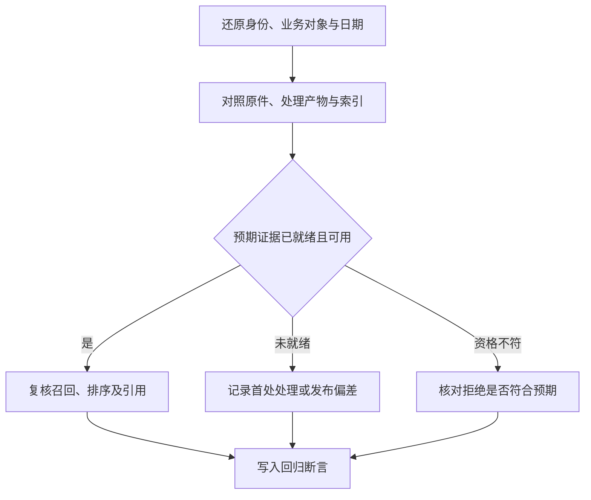

# 14｜用户说「这条搜不出来」，怎么把它变成回归测试？

**企业级知识库设计与检索质量工程 · 第四阶段**  
阅读约 30–35 分钟 · 可选练习约 10 分钟 · 投诉、诊断事件和标注均为合成示例

| 读前要点 | 本篇内容 |
| --- | --- |
| **设计主线** | 把投诉恢复成可回放的查询、身份、业务日期、原件版本和配置，再定位第一处偏差。 |
| **边界场景** | 正确空页、资料缺失、OCR 丢字段、索引尚不可见、配置变化、近似样本跨集污染和敏感内容进入日志。 |
| **方案示例** | 定义最小诊断事件和坏例样本，用两个「都搜不到」的 Atlas 请求区分解析失败与正确权限过滤。 |
| **验收** | 新坏例能复现、能定位、能写出可检查断言；样本进组规则、预期结果及数据访问范围均可复核。 |

一个员工说「Atlas 外包首日门禁，谁提交？明明制度里有，为什么搜不到？」另一位也反馈「搜不到 Atlas 联调区值守点」。第一个查询漏掉了本应从扫描表格生成的证据，第二个人没有项目文档的阅读许可。前台都没显示答案，把两条投诉都当作「召回不够」会得出错误的优化方向。

上一篇定义了答案和原文怎样关联。本篇把这些关系变成诊断记录和回归断言。

## 一、先还原上下文，再沿链路找第一处偏差



从第一项用户期望出发，按顺序找它在哪一层消失。检查资格前，应先弄清原文是否存在，以及缺失是否可经权威来源解释。权限、授权处理和业务规则都可能解释一次空结果。回放要使用隔离的角色夹具或获准的测试身份。生产用户的访问权不能通过不受控的调试途径扩大。

| 检查顺序 | 在哪里找证据 | 归因例子 |
| --- | --- | --- |
| 原件与接入 | 来源键、原件版本、最新同步水位 | 文件未接入，或这次使用的是旧版。 |
| 识别与切片 | 处理批次、页码、表头与字段、证据块 | 第 4 页识别丢了「办理人」，无法形成可靠片段。 |
| 发布与索引 | 审核状态、索引代次、批次水位、读路径确认 | 处理已完成，当前服务代次尚未看到新证据。 |
| 资格与召回 | 权限和业务规则摘要、各路候选、去重前后数量 | 证据因当前访问范围被过滤，或词法与向量都未找到。 |
| 排序与交付 | 候选名次、超时降级、最终复核及返回证据 | 正确证据已在候选中，排到用户可见的 K 条以外。 |
| 主张与引用 | 证据包、逐项支持状态、最终引用 | 命中了证据，但生成时丢了适用条件，或链接跳到另一版。 |

如果多个环节都有问题，优先记录第一处可验证的偏差，并把后续问题列成独立观察。修完后再完整回放。例如补出页 4 的证据，还要验证切片、索引与引用都能处理它。

## 二、保存最少而足够的诊断字段

| 字段 | 例子 | 怎么使用 |
| --- | --- | --- |
| `trace_id`、`case_id` | 本次请求关联 ID、`atlas-14-a` | 将用户反馈与受控的回归样本关联。 |
| `tenant_scope_ref`、`principal_fixture` | 内部范围引用、普通员工夹具 | 记录复现所需的角色和适用策略，生产身份值按权限脱敏。 |
| `subject`、`business_as_of` | 外包、`2026-11-20` | 区分提问者权限与规则的业务适用性。 |
| `source_version_ref`、`artifact_id`、`index_generation` | 入场制度 v3、解析批次 8、G8 | 定位源文件、处理产物和查询读到的索引。 |
| `policy_revisions`、`pipeline_profile` | 权限水位、制度规则版本、检索／生成配置 | 判断回放结果是否可与原请求比较。 |
| `stage`、`outcome`、`reason_code` | `parse`、`failed`、`missing_table_cell` | 快速定位条件不满足的环节。 |
| `counts`、`duration_ms` | 候选量、过滤量、各阶段时间 | 发现索引缺口、超时或降级。 |
| `query_fixture_ref` 或受控指纹 | 经过审阅的合成问句引用 | 联系近似投诉和回放，不必把原始问句写入通用日志。 |

普通日志可以记录这些字段的最小子集。完整问句、受限标题、片段文本和原始权限图只进入有业务需求及访问控制的诊断路径。即使只记录标识，能够跨请求关联的值也需有留存与访问边界。结构化遥测应在采集和导出前检查敏感字段。 [OpenTelemetry · Handling sensitive data](https://opentelemetry.io/docs/security/handling-sensitive-data/)

## 三、两条相似投诉，为什么得到不同验收

| 项目 | A · 外包首日门禁提交人搜不到 | B · Atlas 联调区值守点搜不到 |
| --- | --- | --- |
| 预期 | 普通员工查得到企业内部可读的行政规定 | 当前提问者无权读项目手册，该问题没有其他获准依据 |
| 原文与处理 | 现行制度原件第 4 页有办理人；解析产物对应单元格空白 | 手册内容、解析产物和索引均存在 |
| 首个偏差 | 解析与清洗阶段丢字段 | 无偏差，权威权限检查有意排除 |
| 回归断言 | 正确提取「项目负责人」；结果能跳到第 4 页并带适用条件 | 返回证据不足；响应、引用和模型输入均不含受限内容 |
| 后续动作 | 把跨页表格加入解析回归，补跑源页并复查生效 | 保留负例，作为权限回归的一部分 |

B 还可另建一个 Atlas 成员夹具，验证已获准身份确实查得到正确证据。只测拒绝容易掩盖另一类故障，例如文档本身从未正确入库。按角色、对象与业务日期写出正负配对用例，比只加一个空结果断言更有用。

一个回归样本需要知道「应该发生什么」与「在哪些条件下应该发生」。

```text
case_id = atlas-14-a，family = atlas-first-day-access
输入 = 合成问句 + 普通员工夹具 + 外包对象 + 业务日期 2026-11-20
基线 = 原件 v3 / 解析批次 / 权限与政策快照 / 索引和排序配置
断言 = 表格办理人存在；Top K 命中 A1；主张带有效范围；引用打开第 4 页
```

线上诊断记录用来找根因，回归样本优先用可共享的合成材料。原版无法保留时，可以建立一个等价样本并标记改写关系。样本应记录采用的标注版本、维护人、风险级别和复核时间。标注需要改变时，保留修改原因，并区分业务规则变更和系统缺陷修复。

## 四、怎么分组，避免让单一分数掩盖问题

把测试分成**正例、范围限制、资格拒绝、证据不足、冲突和发布边界**。召回指标只在有合格标注证据的查询上计算；预期空结果、无越权和带充分引用的回答分别验收。阶段层面的例子是同时检查「证据是否进入候选」和「最终 Top K 是否保留」。这样可以判断是召回覆盖还是排序改善了结果。固定查询、语料与相关性标注的做法可参考 TREC。 [NIST TREC Overview](https://trec.nist.gov/overview.html)

把来自同一业务意图和来源的近似问句标同一个 `family`。例如「Atlas 首日门禁谁提单」与「第一天进 Atlas 门要找谁」可以属于同一族。需要调参或训练时，整个查询族只能分到训练、验证或留出中的一处。同一原文的不同清洗版本也可按任务目的加组，避免把几乎相同的证据泄漏到留出集。分组切分的通用思想可参考 GroupKFold。 [scikit-learn GroupKFold](https://scikit-learn.org/stable/modules/generated/sklearn.model_selection.GroupKFold.html)

发布评测还要写清比较对象。解析变更时固定业务、权威和查询标注，比对证据产物与结果；只变排序时保持候选池相同。索引或政策版本变化造成预期变化时，由资料所有者确认新答案，再更新样本。对同一坏例保留首次失败、修复前后证据和相应配置。

## 五、从反馈到下一轮发布的最小流程

1. 客服或产品按规则登记已知症状和范围，使用用户允许的请求关联信息。
2. 平台团队定位首处偏差，确认修复归属。资料缺口交来源所有者，解析、索引和排序分别进入平台待办。
3. 将坏例转换为带时间、角色和期望证据的版本化样本；补充负例和同族边界。
4. 修复后回放，报告变更前后以及受影响的查询族。保留有关权限、删除、有效时间和证据支持的阻断断言。

**可选练习。** 给 A 加入「正确段落已在候选，却排到第 21 位」的变体。写出与解析失败不同的首处归因。然后为 B 补一个项目成员的正例，并注明两条身份用例应共享哪组语料和业务日期。

下一期会把这些回归用例放进发布决策。平均分更好但关键用例退化时，哪些门槛应该阻止切换？
