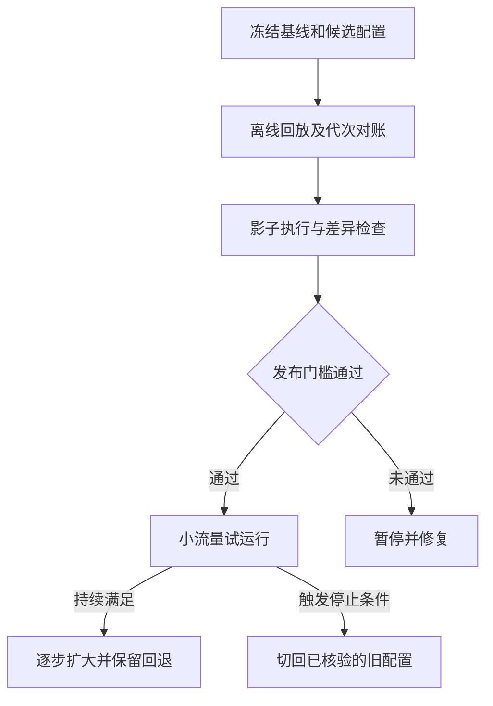

# 15｜替换解析器、切片或 Embedding，怎么知道可以上线？

**企业级知识库设计与检索质量工程 · 第四阶段**  
阅读约 30–35 分钟 · 可选练习约 10 分钟 · 流量、指标与发布决策均为合成示例

| 读前要点 | 本篇内容 |
| --- | --- |
| **设计主线** | 固定可对照的基线，经过离线回放、影子对照和小流量验证，再切换成套的查询配置与索引。 |
| **边界场景** | 总体平均上涨但关键查询退化、冷索引拖慢 P95、候选代次积压、回滚后旧索引重新出现已撤权记录。 |
| **方案示例** | 用 Atlas 的切片变更设计发布记录、分组门槛、切换时序和回滚检查。 |
| **验收** | 能对一份有收益也有退化的报告给出上线决定，并说明何时停止、降级、回滚与重新发布。 |

团队将门禁表格从固定长度切片改成按表行组织。口语「刚入场叫谁办门禁」的首条结果更好了，但 `KB-4032` 这样的精确错误码开始失准。候选的新索引还落后于旧代十几分钟。即使平均分提高，现在切换也可能让不同用户收到含义不同的结果。

第 14 期已经保存了可定位的坏例。我们把它们加入发布回放，再设计一条能保护线上流量的切换路径。解析器或 Embedding 升级也沿用同样的决策过程。

## 一、先定义变了什么，固定其余比较条件

| 字段或记录 | 示例 | 在发布中扮演的角色 |
| --- | --- | --- |
| `release_id`、`owner` | `atlas-r9`、知识平台负责人 | 记录候选、负责方、审批和回滚决定。 |
| `content_snapshot`、`source_watermark` | 原件和文档版本清单、各分区确认水位 | 确保 A、B 比较的是同一批业务资料及变更。 |
| `parse_profile`、`chunk_profile`、`embedding_profile` | 解析 v3、行片段 v2、嵌入 v4 | 明确本轮改动与影响范围，保留查询侧依赖的配对配置。 |
| `index_generation`、`query_profile` | G8、查询配置 Q8 | 引用一套可查询的字段、别名或物理索引、向量配置及排序方式。 |
| `eval_set_version`、`judgment_version` | Atlas 回归集 v6、证据标注 v3 | 用同一版规则比较证据结果。 |
| `traffic_fraction`、`stop_reason` | 5% 试运行、精确编号退化 | 跟踪阶段、观察窗口和停止条件。 |
| `last_known_good`、`compatibility_ref` | G7 与 Q7 的发布清单 | 回滚前核对查询配置、权威状态以及旧代能服务的数据范围。 |

若只改切片，原件、业务日期、权限、水位和人工证据保持一致，让词法、向量等后续字段按已定配置重建。若必须同时更换多个变量，就分步比较或明确报告整包改动，避免把增益归给其中任意一个组件。评测沿用第 14 期的查询族分组与稳定证据定位，两个索引可以包含不同数量的片段，仍按原文证据核对结果。

## 二、给总体指标和关键查询族各自的门槛

以是否在前五条中找到主标注证据为例。下面 160 条查询分成三组，每条计一次。数据用于推演发布决定。

| 查询族 | 用例 | 基线命中 | 候选命中 | 变化 |
| --- | ---: | ---: | ---: | ---: |
| 口语查流程 | 100 | 75 | 87 | +12 个百分点 |
| 精确编号 | 40 | 36 | 32 | −10 个百分点 |
| 制度与边界 | 20 | 17 | 17 | 0 |
| 总体 | 160 | 128（80%） | 136（85%） | +5 个百分点 |

若预先规定「精确编号最多退化 2 个百分点」，该候选就应停止扩大流量。检查点包括专用字段是否继续写入、是否切错证据范围，以及融合或重排是否压低了正确条目。优先看相同 query 的胜负变化，并单列样本量。对罕见的高风险场景，即使样本少，也要逐条检查失败。

| 门槛 | 示例约定 | 如何解读 |
| --- | --- | --- |
| 关键质量 | 精确编号组最多下降 2 个百分点，口语组按目标增长 | 总体改善仍需检查关键子组；样本不足时可增加评测或继续试验。 |
| 授权与删除 | 在测试的每个交付面，未经允许的输出为 0 | 包括模型输入、摘要、引用和原件。出现一次都应暂停并修复。 |
| 延迟 | 已有阅读流量的端到端 P95 不超过 230 ms | 冷、热路径分开看，同时记录错误率、超时、降级和尾延迟。 |
| 新鲜度 | 入库服务到达预定水位，关键来源的可查询延迟符合上限 | 对代次和来源分别统计。单靠索引文档总量无法确认。 |

这些数值为合成门槛。线上项目应先有自己的服务目标、每组最少样本量和测量口径，再选取停止条件与观察窗口。

## 三、从离线到小流量，每一步验证不同的事情



1. **离线回放。** 用标注检查资格、召回、排序、引用和延迟风险。记录两边采用的快照，确保标注能追到同一原文。
2. **影子对照。** 候选接收允许用于试验的请求，只做相同约束下的内部比较。关闭会改变业务状态的操作，按用途批准的范围处理内容及遥测。影子延迟可以发现风险，小流量仍要测真实端到端体验。
3. **小流量试运行。** 将一小组可比较、符合条件的请求稳定路由到候选。记录基线与候选在各组的样本、预热状态、错误和降级，应用预先定义的停止条件，再扩大覆盖。 [Google SRE Workbook · Canarying Releases](https://sre.google/workbook/canarying-releases/)

影子阶段如观察到候选缺了最新变更，应先把两代追回可对照的水位。一个代次的通过条件可以同时包含清单对账、关键来源更新、权限撤回回归和查询读路径验证。

## 四、把索引切换和查询配置放进同一份发布清单

索引只解决一半问题。查询侧也可能用不同的分词字段、向量维度、输入模板或度量。如果先把读路由切到 G8，调用侧仍用 G7 的向量配置，请求就会与目标不匹配。建立一份**可原子选择的发布清单**，以单个版本标识绑定这批配置。每个请求从同一份清单取索引目标和查询配置。

```text
读取同一 release manifest → query_profile、索引目标、数据水位
确认候选已就绪且兼容 → 切换服务指针
请求交付 → 按当前权威目录与授权状态检查
回滚 → 选择上一份已核验清单，再走同样的权威复核
```

索引别名适合切换引擎内的索引目标。如果整个变更跨应用配置、向量索引或多个集群，需要在应用层设计一致的发布指针和兼容窗口。索引别名的具体切换语义以目标引擎版本为准。 [OpenSearch 索引别名](https://docs.opensearch.org/latest/im-plugin/index-alias/)

切换之后，继续监测来源变更是否抵达可交付目标。旧代如果需要用于回滚，应保留足够的同步能力或记录明确的降级策略。在判定候选状态时，不把「有旧索引」视为「旧索引仍满足所有服务条件」。

## 五、回滚什么，以及怎样确定恢复了

| 触发情况 | 第一动作 | 恢复条件 |
| --- | --- | --- |
| 精确编号退化，尚未扩大流量 | 暂停试运行，保留当前基线 | 修复字段或候选缺口，重新通过同一批回归。 |
| 冷索引 P95 越线或多路超时 | 停止扩大；按预案降级到已验证模式，必要时回滚 | 重新测量真实请求的 P95、错误率与降级率。 |
| 候选水位落后 | 冻结切换，检查积压与发布前清单 | 完成所需有效变更的追赶，确认读路径可见。 |
| 返回了已撤权或被删除的证据 | 阻断相应交付路径并核查权威复核 | 无法确认当前授权时收窄结果；复跑权限与原件用例。 |
| 已回滚，旧代含旧权限或过时内容 | 权威门槛继续拦截，必要时按已验证范围降级 | 确认旧代与当前目录、发布规则和授权兼容，才恢复相应流量。 |

回滚选择的是以前的查询配置和索引目标。目录、业务有效期和授权继续使用当前权威状态。若旧代缺新内容或与当前处理权限不兼容，可降级到其他已就绪且验证过的路径，或明确表示证据不足。

**可选练习。** 用表中 160 条查询判断候选能否扩大发布。再加入「候选 P95 243 ms」「切换后项目成员撤权」两条变化，写出暂停、降级、回滚和恢复时各检查什么。

下一期把发布设计接到日常运营。谁要复核 Wiki、谁负责追赶索引、积压时服务优先保证什么，都要能从一张责任表和一份运行手册找到。
