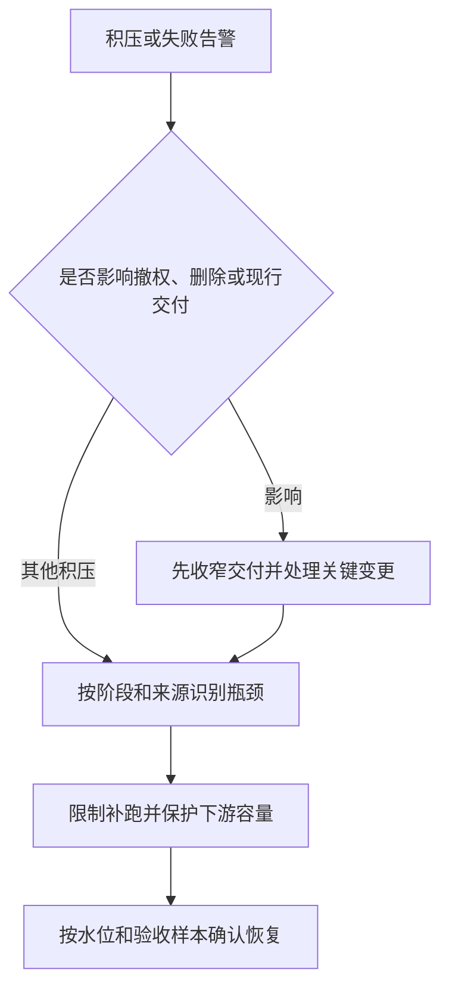

# 16｜企业知识库上线后，谁来维护，怎么持续改进？

**企业级知识库设计与检索质量工程 · 第四阶段**  
阅读约 30–35 分钟 · 可选练习约 10 分钟 · 人员、流量和服务目标均为合成示例

| 读前要点 | 本篇内容 |
| --- | --- |
| **设计主线** | 为知识源、处理链路、权威权限和线上服务分别指定责任，围绕用户能拿到的结果设服务目标。 |
| **边界场景** | 资料无人复核、连接器停更、队列积压、补跑压垮 OCR 或 Embedding、错误集中于某类格式，以及到期清理。 |
| **方案示例** | 提供责任表、试点清单、按阶段与格式的观测字段、限流补跑手册及 Atlas 端到端验收。 |
| **验收** | 能把一份原件追到带引用答案，说明一条告警的归属、保护哪些证据、从哪一步恢复，以及何时需要人工确认。 |

Atlas 入场助手上线后的第一个月，有三类反馈。行政扫描制度的第 4 页识别失败，Wiki 三周没人更新，新材料的批量补跑又把 OCR 队列堵住。用户把三件事都描述成「知识库不好用」。如果没人能说清哪一部分归谁，新的解析器或检索模型也救不了这条流程。

本期把前 15 期接到日常运营。从一项高价值入场流程试点，再按实际数据决定扩什么、修什么、何时暂停。

## 一、给每份关键知识一个负责人

| 对象 | 主要责任方 | 交接条件与证据 |
| --- | --- | --- |
| 行政入场规定 A1 | 行政知识所有者 | 确认正式来源、办理人、适用范围、有效期与复核日期；决定例外和冲突。 |
| 门禁办理矩阵与 IT 入口 I1 | 行政运营与 IT 服务台分别负责各自字段 | 核验区域、办理人与入口。来源版本变化时记录替代关系。 |
| Atlas 联调区手册 P1 | Atlas 空间管理员 | 确定资料用途与成员权限，复核退组、共享与下线场景。 |
| 来源接入、处理、索引及查询 | 知识平台团队 | 对账同步水位、字段保留、索引代次、检索质量和可定位性。 |
| 访问和数据处理策略 | 身份权限团队与数据责任方 | 确认外发边界、撤权处理、留存和删除流程，核对各交付面的验收。 |
| 告警与恢复协调 | 运行值班 | 根据事件分类找到能处理的维护人，记录恢复条件和回归用例。 |

知识源登记卡至少有 `source_id`、`business_owner`、`technical_owner`、`authority_scope`、`review_due_at`、`freshness_target`、`access_policy_ref`、`retention_policy_ref` 和备用联系人。到期没有复核时进入对应的待确认队列。对关键办理步骤，按业务规则决定下线、保留带日期的已核验证据，或交由人工确认。技术团队可以重放资料处理，业务所有者负责确认制度含义。

## 二、试点验收从用户任务开始

首个试点选「外包工程师第一天进 Atlas，谁提交门禁、去哪里申请」。记录测试身份、业务日期、期望出处和可见范围，再确定哪些来源和引擎路径必须到位。引入一个新来源，依次核对资料负责人、授权范围、更新方式和退场清理。运行期间用采集状态和证据质量复核判断能否扩大试点。

| 上线检查 | 怎样验证 |
| --- | --- |
| 能完成一项真实业务任务 | 从行政制度与 IT 目录查到提交人和入口，引用能打开原文版本。 |
| 不同角色看到各自获准内容 | 用普通员工和 Atlas 成员查询联调区补充步骤，随后模拟成员撤权。 |
| 日期和冲突有确定回应 | 已过期版本排除；未决冲突交付可核验状态；入口缺失时只给已支持事项。 |
| 故障路径有人能处理 | 模拟 OCR 丢页、连接器延迟、关键词查询退化，确认告警和恢复责任。 |
| 成本和恢复能估算 | 记录文档格式、页数、各阶段耗时、重试与补跑消耗。 |

扩大范围前，先确保现有来源有人维护、关键问法能覆盖、回归和回滚能重复验证。新增文档量只反映覆盖的一部分，试点更应观察用户能否据此办成事。

## 三、定义能解释用户体验的服务指标

| 指标 | 计量口径示例 | 应按什么分组 |
| --- | --- | --- |
| 查询服务可用性 | 评估期内，符合统计口径的请求中在 1 秒内收到有效终态响应的比例。可正确说明不足的响应仍可计入可用性。 | 入口、租户或范围、查询类型、基线和降级模式。 |
| 证据和引用质量 | 回归标注中，能得到正确证据、真实主张支持和可定位引用的结果比例。 | 用工类型、业务日期、资料格式、权限与冲突等风险场景。 |
| 内容新鲜度 | 成熟观察窗口内，符合发布条件的已确认变更中，在 15 分钟内于服务读路径生效的比例。失败或积压的成熟样本计作未达标。 | 来源、格式、索引代次、变更类型。 |
| 权限与删除阻断 | 撤权或删除确认后，测试是否发现失效内容仍被交付。 | 搜索、摘要、外部模型输入、原件链接、缓存。 |
| 处理成本和积压 | 单位文档或页面成本、重试次数、最老待处理任务年龄、已确认水位与缺口 | 处理阶段、文档格式、来源以及下游服务。 |

服务水平指标（SLI）说明怎样量，服务水平目标（SLO）说明希望达到多少。如果目标是某统计期内可用性 99.5%，10,000 个符合口径的请求允许最多 50 个失败。已有 30 个失败时，还剩 20 个请求的错误预算。例子里的阈值和时间窗需要按真实用户要求设定。授权和删除的负向验收属于独立阻断条件。 [Google SRE Workbook · Implementing SLOs](https://sre.google/workbook/implementing-slos/)

仪表盘可以先做三张图：从接收到发布的年龄分布、按格式的字段缺失率、关键词与语义查询组的质量与延迟。出现故障时，这比一张平均搜索成功率更容易找到实际受影响的路径。

## 四、积压时先保护交付和关键治理动作



| 发现 | 第一行动 | 恢复检查 |
| --- | --- | --- |
| 扫描件 OCR 错误率上升 | 隔离相同来源和格式的失败批次，保留原件，先处理必需页或人工复核。 | 关键字段、原页定位和发布状态一致。 |
| 来源长期停更 | 检查令牌、节流和增量水位，通知来源所有者；按类型决定是否标注已验证日期。 | 完成对账，核对关键最新版本和删除记录。 |
| 大量补跑触发下游限流 | 降低批量速率，为新入库和关键治理事件保留配额。按阶段幂等重跑。 | 最老任务年龄下降、新流量仍满足目标、下游错误恢复。 |
| 撤权或删除未在交付生效 | 先用权威状态收窄或暂停有问题的交付路径，保留诊断证据。 | 索引、缓存、答案与原件入口全部通过回归。 |

补跑前先算净处理能力。例如当前每分钟到达 120 页，下游允许且稳定处理 160 页，每分钟净消化 40 页。在速率稳定、各页平均成本近似的条件下，4,800 页积压大约要 120 分钟。若在确认下游承载后可提高到每分钟 180 页，净消化 60 页，约需 80 分钟。这里还要保留治理任务的处理配额，并按真实流量、重试和失败重新估算。按资源和优先级保护新流量与高价值任务，可参考队列积压和过载的运维实践。 [AWS Builders’ Library · Avoiding insurmountable queue backlogs](https://aws.amazon.com/builders-library/avoiding-insurmountable-queue-backlogs/) · [Google SRE · Handling Overload](https://sre.google/sre-book/handling-overload/)

```text
净消化速度 = 安全处理速率 - 新到达速率
若净消化速度为正，估算恢复时间 = 待处理量 / 净消化速度
就绪验收同时检查关键源水位、读路径、权限与引用
```

## 五、用 Atlas 入场做一场完整演练

| 演练步骤 | 输入与检查 |
| --- | --- |
| 接入与识别 | 登记行政原件 v3，重传同一批次，确认不会产生多份可发布版本。让第 4 页 OCR 失败，校验该页可单独重跑并复核。 |
| 切片与发布 | 把第 3 页表头和第 4 页数据行放进同一个可查证据，保留两处定位。向量延迟时，按第 05 期政策验证词法路径能否先服务。 |
| 提问与引用 | 固定外包首日、普通访客区和业务日期。验证「项目负责人提交」与「办理入口」分别对应 A1 和 I1。 |
| 权限与版本 | 用普通员工及 Atlas 成员检查 P1 只在许可范围内出现。然后撤权并删除旧材料，检查缓存、索引候选与下载均按权威状态过滤。 |
| 迭代与恢复 | 让新切片提高口语查询命中、降低精确编号表现，执行发布停止条件。回滚读路由后再查已撤权资料。 |

演练记录可包括 `case_id`、来源版本、处理产物、索引代次、授权水位、用户角色、期望证据、实际引用、回滚条件和签收人。标记哪些步已在本地或测试环境运行，哪些仍是设计。一次实际演练的结果应能直接转成第 14 期定义的回归样本。

**可选练习。** 给试点补两条运营记录。一条是「4,800 页待处理，OCR 允许能力下降到每分钟 100 页」，写下按现有到达速率会发生什么及如何恢复。另一条是「旧 Wiki 写错办理人后被员工投诉」，写下业务所有者、技术负责方和复查任务。

到这里，Atlas 案例从一份扫描制度走到了可核验的回答，再经历撤权、切换和积压。完成这套设计时，可用三份材料验收自己的系统：一张业务与技术链路图、一组从原件到引用的回归用例，以及一份能找到责任人和恢复条件的运行手册。
